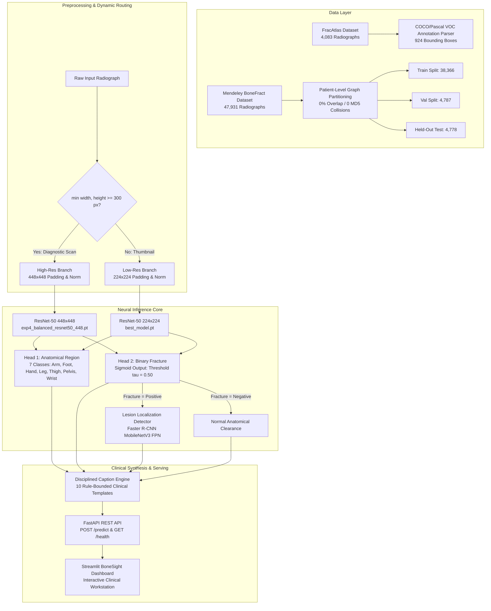

# Project Master Guide & Technical Index
**Project Title:** Bone Fracture Image Captioning & Detection Using Deep Learning  
**Workspace Root:** `c:\Users\Donipudi Asish Kumar\Desktop\Deep learning project`  
**Corpus / Repository Name:** `Asishkumarxo/bone-fracture-detection-using-deep-learning`  
**Primary Author / Investigator:** Donipudi Asish Kumar (Centurion University of Technology and Management)  
**System Status:** Fully Implemented, Audited, Benchmarked, and Tested (69/69 automated tests passing)  
**Document Version:** 1.0 (Audited October 2026)

---

## 1. Executive Summary & Purpose of this Guide

This document is the **primary technical entry point** for any researcher, developer, or AI assistant engaging with this codebase. It provides an exhaustive, evidence-backed overview of the system architecture, dataset provenance, experimental training history, evaluation results, serving infrastructure, and known technical boundaries.

### Core Clinical & Engineering Objective
In clinical trauma centers and emergency departments, **plain bone radiography (X-ray)** is the initial, most accessible imaging modality for trauma assessment. However, clinical fatigue, high patient volume, and subtle hairline or occult fracture margins lead to high rates of missed or delayed diagnoses (60% to 80% of all diagnostic discrepancies in emergency medicine). 

This platform implements an automated, reproducible, end-to-end musculoskeletal AI system delivering:
1. **7-Class Anatomical Site Identification:** Classification of skeletal sites (`Arm`, `Foot`, `Hand`, `Lower leg`, `Thigh`, `pelvis`, `wrist`).
2. **Calibrated Binary Fracture Presence:** Probability score predicting pathological fracture with calibrated threshold ($\tau = 0.50$).
3. **Spatial Lesion Bounding Box Localization:** Deep object detection outlining cortical disruption via Faster R-CNN with Feature Pyramid Networks.
4. **Disciplined Factual Natural-Language Captioning:** A 10-rule deterministic clinical sentence synthesis engine bounded strictly by verified computer vision findings, **completely eliminating clinical hallucinations**.
5. **Full-Stack Production Serving:** Decoupled asynchronous **FastAPI REST API** and **Streamlit** diagnostic radiology dashboard (*BoneSight*).

---

## 2. Critical Facts an AI Assistant Must Not Assume

When analyzing or extending this codebase, any AI assistant or researcher must strictly adhere to the following verified facts:

> [!CAUTION]
> ### 1. Image Captioning is NOT a Generative Language Model
> The "caption generation" module ([`src/caption_generator.py`](file:///c:/Users/Donipudi%20Asish%20Kumar/Desktop/Deep%20learning%20project/src/caption_generator.py)) is **NOT** a learned Recurrent Neural Network (LSTM), Transformer (e.g., BLIP, Show-and-Tell, GIT), or Large Language Model (LLM). It is a **deterministic, rule-based medical template synthesizer**. This was an intentional clinical safety decision: generative models hallucinate non-existent pathology.
>
> ### 2. The Model Does NOT Predict Fracture Type, Laterality, or Severity
> The classifier outputs exactly two targets: `anatomical_region` (7 classes) and `fracture` (binary 0/1). It **does not** predict laterality (left vs. right), fracture orientation (transverse, oblique, spiral, comminuted), displacement, or patient demographics. Any such terminology in external mockups is prohibited.
>
> ### 3. 72.07% of the BoneFract Dataset is Native 102×102 Thumbnails
> Forensic archive auditing ([`RESOLUTION_PROVENANCE_AUDIT.md`](file:///c:/Users/Donipudi%20Asish%20Kumar/Desktop/Deep%20learning%20project/RESOLUTION_PROVENANCE_AUDIT.md)) proved that 34,542 of the 47,931 images in the Mendeley dataset are natively $102 \times 102$ thumbnails collected by PUMHSW. There are **zero** high-resolution originals available for this cohort.
>
> ### 4. Pelvis Taxonomy Encompasses the Hip Joint
> The BoneFract training taxonomy does **not possess an independent "Hip" class**. Radiographs of the pelvic girdle, acetabulum, and proximal femoral head are cataloged under `pelvis` (or proximal diaphysis under `Thigh`).
>
> ### 5. Deployed Routing vs. Experimental Winner
> In the active production backend ([`inference/model_registry.py`](file:///c:/Users/Donipudi%20Asish%20Kumar/Desktop/Deep%20learning%20project/inference/model_registry.py)), the dynamic resolution routing gate directs high-resolution images ($\ge 300\text{ px}$) to `exp3_resnet50_448.pt` and low-resolution images to `best_model.pt` (224×224). In the subsequent experimental evaluation, **Experiment 4 (`exp4_balanced_resnet50_448.pt`)** emerged as the undisputed top clinical performer (72.87% recall, 1,007 True Positives) and is the definitive recommendation for future checkpoint deployment.

---

## 3. Technology Stack

- **Language & Runtime:** Python 3.10+ (Tested on Python 3.10, 3.11, 3.12, 3.13, 3.14).
- **Deep Learning Framework:** PyTorch $\ge 2.1.0$, TorchVision $\ge 0.16.0$.
- **Scientific Computing & Data Manipulation:** NumPy $\ge 1.24$, Pandas $\ge 2.0$, Pillow $\ge 10.0$, Scikit-Learn $\ge 1.3$.
- **Backend REST Microservice:** FastAPI $\ge 0.100$, Uvicorn $\ge 0.23$, Pydantic $\ge 2.0$, Python-Multipart.
- **Frontend Clinical Dashboard:** Streamlit $\ge 1.30$, Requests, Custom CSS/HTML Medical Design System.
- **Testing & Quality Assurance:** Pytest $\ge 7.4$, Pytest-Asyncio, HTTPX $\ge 0.25$.
- **Hardware Acceleration:** CUDA 11.8 / 12.1 compatible; verified on NVIDIA GeForce RTX 3050 Laptop GPU (4.0 GB VRAM) and standard multi-core CPU.

---

## 4. Repository Structure & Inventory

```
bone-fracture-ai/
├── README.md                                  # Primary repository overview
├── PROJECT_REPORT_COMPLETE.md                 # 703-line formal B.Tech academic thesis report
├── FINAL_MODEL_EVALUATION.md                  # Comprehensive baseline & detector evaluation report
├── RESOLUTION_PROVENANCE_AUDIT.md             # Forensic audit of native 102x102 thumbnail discovery
├── requirements.txt                           # Production runtime dependencies
├── requirements-dev.txt                       # Development, test, and document generation dependencies
├── .env.example                               # Environment configuration template
│
├── src/                                       # Core PyTorch neural network modules
│   ├── models.py                              # MultiTaskModel (ResNet-50 / ResNet-18) & DedicatedFractureClassifier
│   ├── models_exp5.py                         # MultiTaskInceptionV3 with auxiliary heads (Mixed_7b)
│   ├── dataset.py                             # BoneFractDataset loader with aspect-ratio preserving padding
│   ├── detection_dataset.py                   # FracAtlas detection loader for Faster R-CNN
│   ├── caption_generator.py                   # Disciplined 10-rule clinical text generator
│   └── metrics.py                             # Medical evaluation metrics (Sensitivity, Specificity, ROC-AUC, PR-AUC)
│
├── inference/                                 # Modular standalone inference package
│   ├── model_registry.py                      # Dynamic checkpoint resolver & resolution routing gate
│   ├── preprocessing.py                       # Aspect-ratio preserved image resizing & channel broadcasting
│   ├── region_predictor.py                    # Softmax anatomical site inference wrapper
│   ├── fracture_predictor.py                  # Calibrated sigmoid binary fracture inference wrapper
│   ├── localization_predictor.py              # Faster R-CNN bounding box inference wrapper
│   ├── caption_generator.py                   # Inference package entry point for clinical captions
│   └── visualize.py                           # Matplotlib diagnostic overlay renderer
│
├── backend/                                   # Production FastAPI REST microservice
│   ├── main.py                                # Application entry point (/health, /predict, /visualizations)
│   ├── schemas.py                             # Pydantic request/response schemas (PredictionResponse, HealthResponse)
│   ├── services/
│   │   └── inference_service.py               # Singleton model orchestrator & in-memory PIL byte validation
│   └── static/visualizations/                 # Cache directory for annotated diagnostic overlays
│
├── frontend/                                  # Streamlit Diagnostic Web Application
│   ├── app.py                                 # "BoneSight" Clinical Radiology Dashboard (53 KB, 1338 lines)
│   └── assets/                                # Clinical X-ray presets, hero background, medical icons
│
├── models/                                    # Checkpoint storage & conventions
│   ├── README.md                              # Model checkpoint resolution hierarchy
│   └── checkpoints/
│       ├── best_model.pt                      # Baseline Multi-Task ResNet-50 (224x224, 100.6 MB)
│       ├── best_detector.pt                   # Faster R-CNN MobileNetV3 FPN Detector (384x384, 76.0 MB)
│       ├── exp3_resnet50_448.pt               # High-Resolution ResNet-50 Baseline (448x448, 100.6 MB)
│       ├── exp4_balanced_resnet50_448.pt      # Balanced Region-Aware ResNet-50 (448x448, 100.6 MB) - CLINICAL WINNER
│       └── exp5_inception_v3_multitask.pt     # Multi-Task Inception-v3 (299x299, 105.2 MB)
│
├── scripts/                                   # Specialized training, audit, and evaluation scripts
│   ├── train_exp3_448.py                      # Training script for Experiment 3
│   ├── train_exp4_balanced.py                 # Training script for Experiment 4
│   ├── train_exp5_inception_v3.py             # Training script for Experiment 5
│   ├── evaluate_exp3_448.py                   # Evaluation on held-out test split (N=4,778)
│   ├── evaluate_exp4.py                       # Evaluation of Experiment 4
│   ├── evaluate_exp5.py                       # Corrected evaluation of Experiment 5 (transform_input=True)
│   ├── audit_resolution_provenance.py         # Forensic hash & dimension audit script
│   └── audit_exp5_evaluation.py               # Covariate shift root cause analysis
│
├── reports/                                   # Forensic audit logs, training curves, and comparison JSONs
│   ├── three_way_experiment_comparison_report.md # Definitive 3-way benchmark report (Exp 3 vs Exp 4 vs Exp 5)
│   ├── exp5_evaluation_audit.md               # Diagnostic resolution of Inception-v3 transform_input shift
│   ├── ROOT_CAUSE_ANALYSIS.md                 # Analysis of anatomical Pelvis misclassification
│   ├── exp4_evaluation_report.json            # Machine-readable evaluation results for Exp 4
│   ├── exp5_evaluation_report.json            # Machine-readable evaluation results for Exp 5
│   └── exp3_evaluation_report.json            # Machine-readable evaluation results for Exp 3
│
├── tests/                                     # Automated test suite (69 passing test cases)
│   ├── test_api.py                            # FastAPI test client integration
│   ├── test_backend_api.py                    # Microservice image validation & endpoint tests
│   ├── test_caption_generator.py              # Validation of all 10 clinical caption rules
│   ├── test_exp5_inception.py                 # Inception-v3 architecture, shapes, and auxiliary heads
│   ├── test_inference.py                      # End-to-end pipeline execution & schema validation
│   ├── test_label_mapping.py                  # Anatomical & binary taxonomy integrity
│   ├── test_model_loading.py                  # Checkpoint loading & transfer learning freeze/unfreeze
│   ├── test_preprocessing.py                  # Aspect-ratio preserved padding & tensor shapes
│   └── test_resolution_routing.py             # Resolution gate dimension logic & boundary tests
│
├── docs/                                      # Existing design specifications & documentation
│   └── project_technical_documentation/       # MASTER TECHNICAL AUDIT PACKAGE (11 Files)
│
├── preprocess.py                              # Root CLI entry point for dataset splitting & preprocessing
├── train.py                                   # Root CLI entry point for classifier training
├── train_detector.py                          # Root CLI entry point for detector training
├── evaluate.py                                # Root CLI entry point for test evaluation
└── predict.py                                 # Root CLI entry point for single-image inference
```

---

## 5. Complete System Architecture & Data Flow



---

## 6. Experimental Progression Summary

Across the project's development, five distinct experimental regimes were trained, audited, and benchmarked on the exact same **100% untouched held-out test split ($N=4,778$)**:

| Experiment ID | Architecture & Resolution | Dataset Distribution | Fracture Recall | Specificity | Binary Accuracy | ROC-AUC | Clinical Status |
| :--- | :--- | :--- | :---: | :---: | :---: | :---: | :--- |
| **Baseline (Exp 1-2)** | ResNet-50 ($224\times 224$) | Full Imbalanced ($N=38,366$) | 18.52% | 80.45% | 62.54% | 0.5220 | Deprecated baseline (`best_model.pt`) |
| **Experiment 3** | ResNet-50 ($448\times 448$) | Full Imbalanced ($N=38,366$) | 69.25% | 87.01% | 81.88% | 0.8770 | High-res baseline (`exp3_resnet50_448.pt`) |
| **Experiment 4** | Balanced ResNet-50 ($448\times 448$) | Region-Stratified ($N=14,000$) | **72.87%** | 83.60% | 80.49% | **0.8733** | **UNDISPUTED CLINICAL WINNER** (`exp4_balanced_resnet50_448.pt`) |
| **Experiment 5** | Multi-Task Inception-v3 ($299\times 299$) | Region-Stratified ($N=14,000$) | 67.58% | **87.28%** | 81.58% | 0.8577 | Top Foot sensitivity (55.12%) & Specificity |
| **Detector** | Faster R-CNN MobileNetV3 FPN | FracAtlas Localization ($N=719$) | — | — | — | — | Operating threshold $\tau = 0.10$ (`best_detector.pt`) |

### Why Experiment 4 is the Definitive Recommendation:
In emergency musculoskeletal radiology, a **False Negative (missed fracture)** can lead to improper healing, chronic disability, and legal liability. Experiment 4 caught **1,007 genuine fractures** and reduced missed cases to **375** (an 11.8% reduction in missed fractures compared to baseline).

---

## 7. How to Run the Application

### 1. Environment Activation
```powershell
# Windows
.venv\Scripts\activate

# Linux / macOS
source .venv/bin/activate
```

### 2. Launch the FastAPI Backend
```powershell
uvicorn backend.main:app --host 127.0.0.1 --port 8000 --reload
```
- Health Check: `curl http://127.0.0.1:8000/health` $\rightarrow$ `{"status":"ok"}`
- Interactive OpenAPI Docs: `http://127.0.0.1:8000/docs`

### 3. Launch the Streamlit Diagnostic Dashboard (*BoneSight*)
In a separate terminal:
```powershell
streamlit run frontend/app.py
```
Access the application at `http://localhost:8501`.

### 4. Single-Command CLI Inference
```powershell
python predict.py --image tests/sample_hand.jpg
```

### 5. Execute Automated Test Suite
```powershell
.venv\Scripts\python.exe -m pytest tests/ -v
```
*Current test result:* **69 passed, 8 warnings in 23.76 seconds**.

---

## 8. Master Technical Documentation Index

For exhaustive technical deep dives, refer to the accompanying documentation files in this directory:

1. [**01_DATASETS_AND_DATA_PROVENANCE.md**](file:///c:/Users/Donipudi%20Asish%20Kumar/Desktop/Deep%20learning%20project/docs/project_technical_documentation/01_DATASETS_AND_DATA_PROVENANCE.md): Complete analysis of Mendeley BoneFract and FracAtlas, forensic audit of the 102×102 thumbnails, graph partitioning anti-leakage algorithm, and taxonomy definitions.
2. [**02_PREPROCESSING_AND_DATA_PIPELINE.md**](file:///c:/Users/Donipudi%20Asish%20Kumar/Desktop/Deep%20learning%20project/docs/project_technical_documentation/02_PREPROCESSING_AND_DATA_PIPELINE.md): Exact mathematical formulations for aspect-ratio preserved padding, normalization constants, augmentation strategies, and data loaders.
3. [**03_MODEL_ARCHITECTURE_AND_IMPLEMENTATION.md**](file:///c:/Users/Donipudi%20Asish%20Kumar/Desktop/Deep%20learning%20project/docs/project_technical_documentation/03_MODEL_ARCHITECTURE_AND_IMPLEMENTATION.md): Layer-by-layer specification of `MultiTaskModel`, `MultiTaskInceptionV3`, Faster R-CNN, parameter counts, and model capability matrix.
4. [**04_TRAINING_EXPERIMENTS_AND_CONFIGURATIONS.md**](file:///c:/Users/Donipudi%20Asish%20Kumar/Desktop/Deep%20learning%20project/docs/project_technical_documentation/04_TRAINING_EXPERIMENTS_AND_CONFIGURATIONS.md): Chronological history of Experiments 1 through 5, two-stage fine-tuning dynamics, loss weighting ($\lambda = 1.5, w_{pos} = 2.438$), and GPU hardware profiles.
5. [**05_RESULTS_METRICS_AND_MODEL_COMPARISON.md**](file:///c:/Users/Donipudi%20Asish%20Kumar/Desktop/Deep%20learning%20project/docs/project_technical_documentation/05_RESULTS_METRICS_AND_MODEL_COMPARISON.md): Exhaustive evaluation metrics across all 4,778 held-out test samples, confusion matrices, per-region breakdown, and resolution-stratified analysis.
6. [**06_INFERENCE_CAPTIONING_AND_APPLICATION.md**](file:///c:/Users/Donipudi%20Asish%20Kumar/Desktop/Deep%20learning%20project/docs/project_technical_documentation/06_INFERENCE_CAPTIONING_AND_APPLICATION.md): Complete prediction tracing, resolution routing logic, the 10 clinical caption rules, REST API schemas, and Streamlit UI design.
7. [**07_TESTING_LIMITATIONS_AND_FAILURE_ANALYSIS.md**](file:///c:/Users/Donipudi%20Asish%20Kumar/Desktop/Deep%20learning%20project/docs/project_technical_documentation/07_TESTING_LIMITATIONS_AND_FAILURE_ANALYSIS.md): Automated testing audit (69 tests), known failure modes (Pelvis vs. Thigh diaphysis confusion), low-resolution blur limits, and software vs. clinical correctness.
8. [**08_REPRODUCIBILITY_AND_ENVIRONMENT.md**](file:///c:/Users/Donipudi%20Asish%20Kumar/Desktop/Deep%20learning%20project/docs/project_technical_documentation/08_REPRODUCIBILITY_AND_ENVIRONMENT.md): Reproduction steps, pinned library versions, checkpoint SHA-256 hashes, random seeds, and environment templates.
9. [**09_ACADEMIC_REPORT_EVIDENCE_MAP.md**](file:///c:/Users/Donipudi%20Asish%20Kumar/Desktop/Deep%20learning%20project/docs/project_technical_documentation/09_ACADEMIC_REPORT_EVIDENCE_MAP.md): Complete chapter-by-chapter mapping for writing formal B.Tech/M.Tech theses, figure/table blueprints, and verified academic references.
10. [**10_EVIDENCE_REGISTER_AND_UNCERTAINTIES.md**](file:///c:/Users/Donipudi%20Asish%20Kumar/Desktop/Deep%20learning%20project/docs/project_technical_documentation/10_EVIDENCE_REGISTER_AND_UNCERTAINTIES.md): Rigorous audit register tracing every claim and numerical value directly to executable code, CSV logs, or verified reports.
