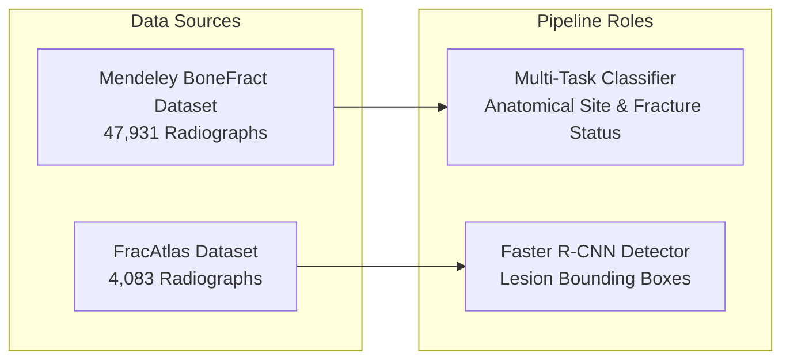
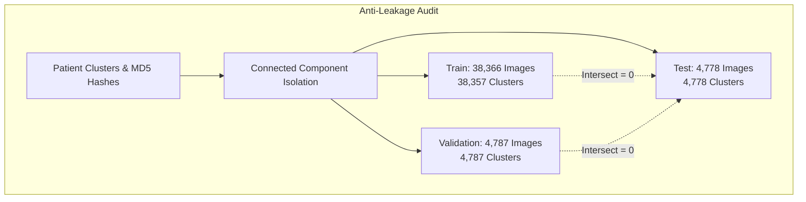

# Datasets and Data Provenance
**Project:** Bone Fracture Image Captioning & Detection Using Deep Learning  
**Scope:** Forensic provenance audit, dataset reconciliation, graph partitioning anti-leakage protocol, and class distribution analysis.  
**Audited Datasets:** Mendeley BoneFract & FracAtlas  
**Document Version:** 1.0 (Audited October 2026)

---

## 1. Primary Datasets Overview

This project utilizes two independent clinical radiographic repositories, each serving a distinct function in the multi-stage machine learning pipeline:

---

## 2. Dataset 1: Mendeley BoneFract

### 2.1 Bibliographic & Source Details
* **Official Name:** BoneFract: A Bone Fracture Dataset
* **Contributing Institution:** Peoples University of Medical and Health Sciences for Women (PUMHSW), Nawabshah, Pakistan.
* **Publication Venue:** Mendeley Data (Version 1, Published 2023).
* **Identifier / DOI:** `doi:10.17632/jhqrxmff7v`
* **Direct Access URL:** [https://data.mendeley.com/datasets/jhqrxmff7v/1](https://data.mendeley.com/datasets/jhqrxmff7v/1)
* **License:** Creative Commons Attribution 4.0 International (CC BY 4.0). Allows academic and commercial adaptation with appropriate attribution.
* **Original Archive Name:** `BoneFract A Bone Fracture Dataset.zip` (3.25 GB compressed, containing 47,931 image files and 2 Excel sheets).

### 2.2 Anatomical Scope & Class Definitions
The dataset catalogs standard plain radiographs across **7 anatomical regions**:
1. `Arm`: Humerus, radius, and ulna projections.
2. `Foot`: Tarsal, metatarsal, and phalangeal projections.
3. `Hand`: Carpal, metacarpal, and phalangeal projections.
4. `Lower leg`: Tibial and fibular projections.
5. `Thigh`: Femoral shaft and diaphysis projections.
6. `pelvis`: Pelvic girdle, sacroiliac joints, acetabulum, and proximal femoral head projections.
7. `wrist`: Distal radius, distal ulna, and proximal carpal row projections.

> [!NOTE]
> **Taxonomy Boundary Note on Pelvis vs. Hip:**  
> The BoneFract dataset does **not possess an independent "Hip" class**. Studies of the hip joint and femoral neck are cataloged under `pelvis` (or proximal femur under `Thigh`). This taxonomy design is the primary contributor to anatomical confusion for hip examinations.

### 2.3 Original Image Characteristics
* **Total Image Count:** 47,931 radiographs.
* **Unique Patients (Clusters):** 47,922 unique patient identifiers (`patientXXXXX`).
* **Image Format:** PNG (lossless compression).
* **Color Space / Channels:** 8-bit single-channel Grayscale (rendered as `(H, W, 1)` or `(H, W, 3)` upon loading).
* **Original Resolutions:** Bimodal distribution:
  - **Native Low-Resolution Cohort:** Exactly $102 \times 102$ pixels (72.07%).
  - **Diagnostic High-Resolution Cohort:** $300 \times 300$ to $1920 \times 876$ pixels (27.93%).

### 2.4 Class Balance & Positive Fracture Prevalence
Across all 47,931 curated radiographs:
* **Normal / Negative Studies:** 34,010 images (**70.96%**)
* **Fractured / Positive Studies:** 13,921 images (**29.04%**)
* **Positive Prevalence Ratio:** 1 : 2.443 (requiring positive loss weighting during training, $w_{\text{pos}} = 2.438$).

---

## 3. Forensic Discovery: Provenance of the 102×102 Images

During initial experiments (Experiment 3), upscaling raw images to $448 \times 448$ resulted in poor fracture sensitivity on low-resolution images (38.20% recall), despite achieving 90.91% recall on high-resolution images. A forensic audit was initiated ([`scripts/audit_resolution_provenance.py`](file:///c:/Users/Donipudi%20Asish%20Kumar/Desktop/Deep%20learning%20project/scripts/audit_resolution_provenance.py)) to determine whether the $102 \times 102$ images were compressed thumbnails of higher-resolution scans or native images.

### Forensic Audit Findings ([`RESOLUTION_PROVENANCE_AUDIT.md`](file:///c:/Users/Donipudi%20Asish%20Kumar/Desktop/Deep%20learning%20project/RESOLUTION_PROVENANCE_AUDIT.md)):
1. **Native Nature of the 102×102 Cohort:**  
   The $102 \times 102$ images are **native images** collected and published directly by PUMHSW. They represent **34,542 of the 47,931 images (72.07%)**.
2. **Absence of High-Resolution Counterparts:**  
   The underlying 3.25 GB distribution ZIP (`BoneFract A Bone Fracture Dataset.zip`) contains exactly 47,931 images and zero DICOM, TIFF, or alternative uncompressed high-resolution files.
3. **Completely Disjoint Patient Populations:**  
   The $102 \times 102$ cohort and the higher-resolution cohort ($\ge 300\times 300$) have **zero patient ID overlap** and **zero perceptual hash (pHash) correlation**. They represent completely distinct patients examined on different hospital sensor systems, not downsampled thumbnails of existing images.
4. **Resolution-Aware Routing Mandate:**  
   Because 72% of the data is permanently low-resolution, upscaling them to $448\times 448$ introduces interpolation blur, while downsampling clinical high-resolution scans destroys hairline fracture lines. This necessitated the **automated resolution-aware routing gate**.

---

## 4. Dataset 2: FracAtlas

### 4.1 Bibliographic & Source Details
* **Official Name:** FracAtlas: A Dataset for Bone Fracture Classification, Detection and Segmentation
* **Contributing Authors:** Iftekhar et al. (BRAC University & Bangladesh medical centers).
* **Publication Venue:** *Nature Scientific Data* (Vol. 10, Article 586, Published 2023).
* **Identifier / DOI:** `doi:10.1038/s41597-023-02432-4`
* **Direct Access URL:** [https://figshare.com/articles/dataset/22634356](https://figshare.com/articles/dataset/22634356)
* **License:** Creative Commons Attribution 4.0 International (CC BY 4.0).
* **Storage Location in Project:** `data/FracAtlas/`

### 4.2 Annotation Scope & Technical Role
* **Total Radiographs:** 4,083 clinical radiographs.
* **Positive Fracture Studies:** 719 radiographs containing **924 expert-annotated lesion bounding boxes**.
* **Annotation Formats:** COCO JSON (`COCO_fracture_masks.json`) and Pascal VOC XML bounding box representations.
* **Role in Pipeline:** Training and validating the **Faster R-CNN MobileNetV3-Large FPN detector** ([`src/detection_dataset.py`](file:///c:/Users/Donipudi%20Asish%20Kumar/Desktop/Deep%20learning%20project/src/detection_dataset.py)).
* **Anatomical Distribution:** Hand (1,538), Leg (2,273), Hip (338), Shoulder (349), Mixed (398).

---

## 5. Patient-Level Graph Partitioning Protocol (Anti-Leakage)

In medical computer vision, partitioning datasets randomly by image file introduces **severe data leakage**: multiple radiographs of the same patient or duplicate uploads end up in both training and test sets, artificially inflating reported test performance.

To guarantee zero data contamination, the project implemented an automated graph-connected component partitioning protocol ([`preprocess.py`](file:///c:/Users/Donipudi%20Asish%20Kumar/Desktop/Deep%20learning%20project/preprocess.py), `cluster_and_partition()`):

### 5.1 Partitioning Algorithm
1. **Graph Construction:** Formulate an undirected bipartite graph $G = (V, E)$ where vertices represent patient IDs and exact MD5 file hashes.
2. **Edge Formation:** An edge connects a patient identifier to an image hash if that patient was imaged in that file.
3. **Connected Components:** Extract connected subgraphs $\{C_1, C_2, \dots, C_k\}$. All images belonging to a single connected component share identical or related patient identifiers.
4. **Stratified Splitting:** Partition the connected components into **80% Train, 10% Validation, and 10% Held-Out Test**, stratifying across both anatomical region and fracture prevalence.

### 5.2 Split Summary Table

| Partition | Patient Clusters | Total Images | Normal (Negative) | Fracture (Positive) | Positive Ratio | Verification Status |
| :--- | :---: | :---: | :---: | :---: | :---: | :---: |
| **Train (80%)** | 38,357 | **38,366** | 27,205 | 11,161 | 29.09% | Disjoint |
| **Validation (10%)** | 4,787 | **4,787** | 3,409 | 1,378 | 28.79% | Disjoint |
| **Held-Out Test (10%)**| 4,778 | **4,778** | 3,396 | 1,382 | 28.92% | **100% Isolated** |
| **Total Corpus** | **47,922** | **47,931** | **34,010** | **13,921** | **29.04%** | Zero Collision |

### 5.3 Automated Forensic Leakage Audits ([`FINAL_MODEL_EVALUATION.md`](file:///c:/Users/Donipudi%20Asish%20Kumar/Desktop/Deep%20learning%20project/FINAL_MODEL_EVALUATION.md))
- **Cross-Split Patient Overlap:** $\text{Train} \cap \text{Test} = \emptyset$, $\text{Train} \cap \text{Val} = \emptyset$, $\text{Val} \cap \text{Test} = \emptyset$ (Passed 100%).
- **Exact Hash Collision Test:** Zero MD5 hash collisions between splits.
- **Normalization Leakage Audit:** Preprocessing normalization constants were hardcoded fixed constants ($\mu=0.5, \sigma=0.5$ or ImageNet $\mu=[0.485, 0.456, 0.406]$); zero test-set statistics were computed during training.

---

## 6. Stratified Anatomical & Resolution Breakdown Across Splits

### 6.1 Anatomical Distribution

| Anatomical Region | Train Count | Validation Count | Test Count | Total Images | Split Ratio (Train/Val/Test) |
| :--- | :---: | :---: | :---: | :---: | :---: |
| **Lower leg** | 8,797 | 1,101 | 1,098 | 10,996 | 80.0% / 10.0% / 10.0% |
| **pelvis** | 5,596 | 696 | 691 | 6,983 | 80.1% / 10.0% / 9.9% |
| **Foot** | 5,459 | 684 | 697 | 6,840 | 79.8% / 10.0% / 10.2% |
| **Hand** | 4,833 | 605 | 594 | 6,032 | 80.1% / 10.0% / 9.9% |
| **wrist** | 4,814 | 607 | 599 | 6,020 | 80.0% / 10.1% / 10.0% |
| **Arm** | 4,467 | 572 | 558 | 5,597 | 79.8% / 10.2% / 10.0% |
| **Thigh** | 4,400 | 522 | 541 | 5,463 | 80.5% / 9.6% / 9.9% |
| **Total** | **38,366** | **4,787** | **4,778** | **47,931** | **80.0% / 10.0% / 10.0%** |

### 6.2 Stratified Native Resolution Breakdown

| Native Resolution Tier | Train (N=38,366) | Validation (N=4,787) | Test (N=4,778) | Total Corpus | Proportion |
| :--- | :---: | :---: | :---: | :---: | :---: |
| **Native Low-Res ($102\times 102$)** | 27,618 | 3,463 | 3,461 | **34,542** | **72.07%** |
| **Diagnostic High-Res ($\ge 300\times 300$)** | 10,748 | 1,324 | 1,317 | **13,389** | **27.93%** |

In the held-out test split of 4,778 images:
- **Low-Res Thumbnails ($102\times 102$):** 3,461 images (568 Positive, 2,893 Negative)
- **High-Res Studies ($\ge 300\times 300$):** 1,317 images (814 Positive, 503 Negative)

---

## 7. Region-Balanced Fine-Tuning Manifest (Experiments 4 & 5)

To eliminate anatomical class imbalance (e.g., Lower leg having 8,797 training samples vs. Thigh having 4,400), a curated, region-stratified dataset was engineered for Experiments 4 and 5 ([`reports/exp4_sample_manifest.csv`](file:///c:/Users/Donipudi%20Asish%20Kumar/Desktop/Deep%20learning%20project/reports/exp4_sample_manifest.csv)):

* **Total Curated Training Samples:** **14,000 images**
* **Samples per Anatomical Region:** Exactly **2,000 images** across each of the 7 anatomical regions:
  - `Arm`: 2,000
  - `Foot`: 2,000
  - `Hand`: 2,000
  - `Lower leg`: 2,000
  - `Thigh`: 2,000
  - `pelvis`: 2,000
  - `wrist`: 2,000
* **Manifest Integrity:** SHA-256 hash verified as `114bd802b57177381cf3fec597d536831c2310bc091cdbebbee859bdc7f41252`.
* **Zero Leakage:** Strictly sampled from the designated 80% training split (`train.csv`); zero test or validation samples included.
