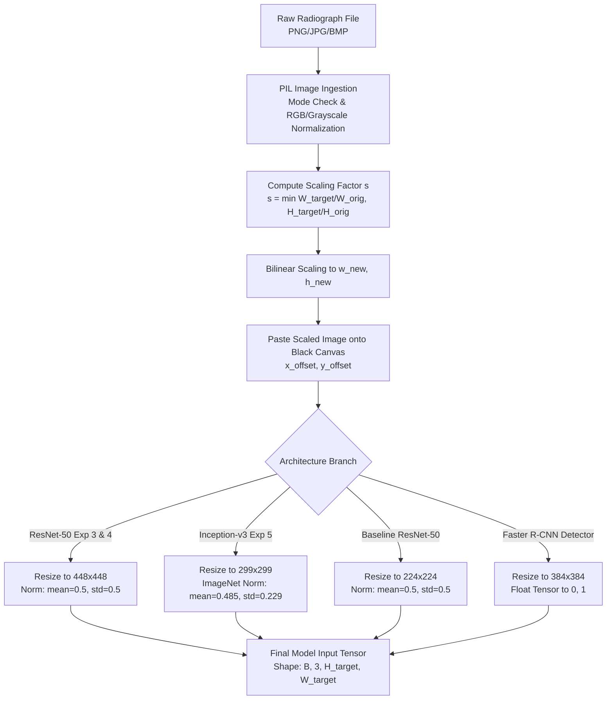

# Data Preprocessing and Preparation Pipeline
**Project:** Bone Fracture Image Captioning & Detection Using Deep Learning  
**Scope:** Mathematical formulation of image transformation, aspect-ratio preservation, normalization regimes, data augmentation, batching, and tensor preparation.  
**Source Code References:** [`preprocess.py`](file:///c:/Users/Donipudi%20Asish%20Kumar/Desktop/Deep%20learning%20project/preprocess.py), [`inference/preprocessing.py`](file:///c:/Users/Donipudi%20Asish%20Kumar/Desktop/Deep%20learning%20project/inference/preprocessing.py), [`src/dataset.py`](file:///c:/Users/Donipudi%20Asish%20Kumar/Desktop/Deep%20learning%20project/src/dataset.py)  
**Document Version:** 1.0 (Audited October 2026)

---

## 1. Overview & Preprocessing Philosophy

In medical radiography, standard computer vision resizing approaches (e.g., directly resizing non-square radiographs to $224\times 224$ or $448\times 448$ via bilinear interpolation) alter anatomical aspect ratios. For example, compressing a tall, narrow femoral radiograph horizontally distorts cortical thickness, alters trabecular angles, and deforms fracture lines.

To preserve geometric anatomical integrity, this platform implements **deterministic aspect-ratio preserving padding** across all training, evaluation, and inference pipelines.



---

## 2. Image Decoding & Geometric Transformation

### 2.1 Image Loading & Bit Depth
`[Source: inference/preprocessing.py, load_and_validate_image()]`
- Images are ingested via `PIL.Image.open()`.
- The in-memory buffer undergoes validation via `raw_im.verify()` to prevent malicious or corrupted payloads from reaching GPU tensors.
- 8-bit single-channel grayscale radiographs are loaded and converted to 3-channel RGB via `.convert('RGB')` by broadcasting the luminance channel across R, G, and B. This preserves compatibility with backbones pretrained on ImageNet without altering relative pixel intensities.

### 2.2 Mathematical Formulation of Aspect-Ratio Preserved Padding
`[Source: src/dataset.py, BoneFractDataset.__getitem__() & inference/preprocessing.py, resize_and_pad()]`

Given an original image of width $W_{\text{orig}}$ and height $H_{\text{orig}}$, and a target square canvas of dimension $S \times S$ (where $S \in \{224, 299, 384, 448\}$):

1. **Calculate the Uniform Scaling Factor $s$:**
   $$s = \min\left( \frac{S}{W_{\text{orig}}}, \frac{S}{H_{\text{orig}}} \right)$$

2. **Compute New Scaled Dimensions $(W_{\text{new}}, H_{\text{new}})$:**
   $$W_{\text{new}} = \text{round}(W_{\text{orig}} \cdot s), \quad H_{\text{new}} = \text{round}(H_{\text{orig}} \cdot s)$$
   where $W_{\text{new}} \le S$ and $H_{\text{new}} \le S$, with at least one dimension exactly equal to $S$.

3. **Compute Symmetric Offsets for Canvas Centering:**
   $$X_{\text{offset}} = \left\lfloor \frac{S - W_{\text{new}}}{2} \right\rfloor, \quad Y_{\text{offset}} = \left\lfloor \frac{S - H_{\text{new}}}{2} \right\rfloor$$

4. **Canvas Composition:**
   A new solid black background canvas of size $(S, S, 3)$ with pixel values $0$ is created. The scaled image is pasted at coordinates $(X_{\text{offset}}, Y_{\text{offset}})$.

---

## 3. Resolution Tiers & Normalization Regimes

Different model architectures and experiments use distinct input resolutions and normalization parameters:

| Experiment / Subsystem | Architecture | Input Resolution | Canvas Color | Normalization Mean ($\mu$) | Normalization Std ($\sigma$) | Normalization Formula |
| :--- | :--- | :---: | :---: | :---: | :---: | :--- |
| **Baseline (Exp 1-2)** | ResNet-50 | $224 \times 224$ | Black (0,0,0) | $[0.5, 0.5, 0.5]$ | $[0.5, 0.5, 0.5]$ | $x_{\text{norm}} = (x / 255.0 - 0.5) / 0.5 \in [-1, 1]$ |
| **Experiment 3** | ResNet-50 | $448 \times 448$ | Black (0,0,0) | $[0.5, 0.5, 0.5]$ | $[0.5, 0.5, 0.5]$ | $x_{\text{norm}} = (x / 255.0 - 0.5) / 0.5 \in [-1, 1]$ |
| **Experiment 4** | Balanced ResNet-50 | $448 \times 448$ | Black (0,0,0) | $[0.5, 0.5, 0.5]$ | $[0.5, 0.5, 0.5]$ | $x_{\text{norm}} = (x / 255.0 - 0.5) / 0.5 \in [-1, 1]$ |
| **Experiment 5** | Inception-v3 | $299 \times 299$ | Black (0,0,0) | $[0.485, 0.456, 0.406]$ | $[0.229, 0.224, 0.225]$ | ImageNet PyTorch standard with `transform_input=True` |
| **Lesion Detector** | Faster R-CNN | $384 \times 384$ | N/A | $[0.485, 0.456, 0.406]$ | $[0.229, 0.224, 0.225]$ | Internal TorchVision FPN normalizer |

### Resolution Rationale:
- **ResNet-50 at 448×448:** Higher spatial resolution (448×448 vs. 224×224) provides **$4\times$ the pixel area**, preserving hairline cortical fractures that are otherwise blurred out at 224×224.
- **Inception-v3 at 299×299:** Inception-v3's native grid size is 299×299. Pretrained convolutional filters expect ImageNet statistics.

---

## 4. Training-Time Data Augmentation

`[Source: src/dataset.py, get_transforms()]`

To prevent overfitting on repetitive positioning and clinical contrast variations, training data undergoes stochastic online augmentation:

```python
train_transforms = transforms.Compose([
    # 1. Deterministic Aspect-Ratio Padding to Target Size
    ResizeAndPad(target_size=target_size),
    
    # 2. Random Horizontal Flip (simulates bilateral anatomy)
    transforms.RandomHorizontalFlip(p=0.5),
    
    # 3. Subtle Rotation (simulates non-standard patient positioning)
    transforms.RandomRotation(degrees=(-10, 10)),
    
    # 4. Subtle Affine Translation
    transforms.RandomAffine(degrees=0, translate=(0.04, 0.04)),
    
    # 5. Photometric Contrast/Brightness Jitter (simulates exposure variances)
    transforms.ColorJitter(brightness=0.1, contrast=0.1),
    
    # 6. Tensor Conversion and Channel Normalization
    transforms.ToTensor(),
    transforms.Normalize(mean=norm_mean, std=norm_std)
])
```

### Validation & Test Transforms (Zero Stochasticity):
```python
eval_transforms = transforms.Compose([
    ResizeAndPad(target_size=target_size),
    transforms.ToTensor(),
    transforms.Normalize(mean=norm_mean, std=norm_std)
])
```

---

## 5. Label Encoding & Mapping

`[Source: inference/model_registry.py, lines 79-98]`

### 5.1 Anatomical Region Mapping (Task 1)
7 mutually exclusive anatomical categories mapped to integer indices:
```python
REGION_TO_IDX = {
    'Arm': 0,
    'Foot': 1,
    'Hand': 2,
    'Lower leg': 3,
    'Thigh': 4,
    'pelvis': 5,
    'wrist': 6
}
IDX_TO_REGION = {v: k for k, v in REGION_TO_IDX.items()}
```

### 5.2 Binary Fracture Status Mapping (Task 2)
```python
FRACTURE_TO_IDX = {'Negative': 0, 'Positive': 1}
IDX_TO_FRACTURE = {0: 'Negative', 1: 'Positive'}
```
- **Loss Encoding:** Negative $\rightarrow 0.0$, Positive $\rightarrow 1.0$.
- **Operating Decision Threshold:** $\tau = 0.50$ (applied to $\sigma(z_{\text{fracture}})$).

---

## 6. Class Imbalance Mitigation Strategies

Two complementary strategies were implemented to handle dataset imbalance:

### 6.1 Positive Class Loss Weighting ($w_{\text{pos}}$)
In the raw training split ($N=38,366$), normal studies outnumber fractures by $27,205 : 11,161$ (prevalence $29.09\%$). The binary cross-entropy loss incorporates a positive class weighting term:
$$w_{\text{pos}} = \frac{N_{\text{neg}}}{N_{\text{pos}}} = \frac{27,205}{11,161} \approx 2.4375$$
In PyTorch: `nn.BCEWithLogitsLoss(pos_weight=torch.tensor([2.438]))`. This penalizes false negatives $2.44\times$ more heavily than false positives.

### 6.2 Stratified Regional Balancing (Experiments 4 & 5)
In the raw dataset, the anatomical distribution is heavily skewed (10,996 Lower leg images vs. 5,463 Thigh images). To balance feature extraction, Experiments 4 and 5 used stratified sampling to select exactly **2,000 images per anatomical region** (14,000 total training samples), eliminating anatomical bias in the shared backbone.

---

## 7. Data Loader Construction & Performance Parameters

`[Source: scripts/train_exp4_balanced.py & scripts/train_exp5_inception_v3.py]`

| Parameter | Experiment 3 | Experiment 4 | Experiment 5 |
| :--- | :---: | :---: | :---: |
| **Input Canvas** | $448 \times 448$ | $448 \times 448$ | $299 \times 299$ |
| **Batch Size** | 16 (or 32 depending on VRAM) | 16 | 8 |
| **DataLoader Workers** | 4 | 4 | 4 |
| **Memory Pinning** | `pin_memory=True` | `pin_memory=True` | `pin_memory=True` |
| **Mixed Precision** | PyTorch AMP (`torch.cuda.amp`) | PyTorch AMP | PyTorch AMP |
| **Shuffle Mode** | `shuffle=True` (Train) / False (Eval) | `shuffle=True` / False | `shuffle=True` / False |

---

## 8. Technical Limitations of Preprocessing

1. **Information Horizon of Low-Resolution Images:**  
   $72.07\%$ of the images are natively $102 \times 102$ pixels. Upscaling these images to $448 \times 448$ using bilinear interpolation fills missing space with interpolated gradients. While this preserves coordinate alignment, it cannot recover high-frequency trabecular micro-cracks that were never captured by the sensor.
2. **Black Border Canvas Padding:**  
   Symmetric zero padding places high-contrast artificial edges between the radiograph border and the black padding ($0.0$). The convolutional network must learn that black borders are non-informative canvas artifacts, which is aided by batch normalization.
