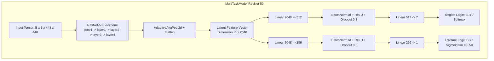
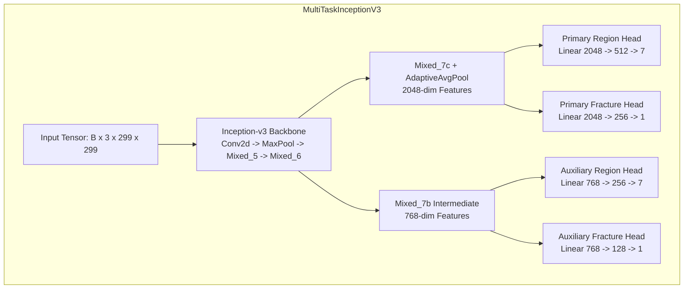

# Model Architecture and Implementation
**Project:** Bone Fracture Image Captioning & Detection Using Deep Learning  
**Scope:** Architectural specifications, tensor dimensions, multi-task branching, parameter counts, loss formulations, and capability verification.  
**Source Code References:** [`src/models.py`](file:///c:/Users/Donipudi%20Asish%20Kumar/Desktop/Deep%20learning%20project/src/models.py), [`src/models_exp5.py`](file:///c:/Users/Donipudi%20Asish%20Kumar/Desktop/Deep%20learning%20project/src/models_exp5.py), [`inference/model_registry.py`](file:///c:/Users/Donipudi%20Asish%20Kumar/Desktop/Deep%20learning%20project/inference/model_registry.py)  
**Document Version:** 1.0 (Audited October 2026)

---

## 1. Architectural Overview

The core diagnostic system uses a **multi-task deep convolutional network**. A shared deep backbone extracts general radiographic features, which are then passed to independent task-specific heads:
1. **Task 1 (Anatomical Region Classification):** 7-class categorical output.
2. **Task 2 (Binary Fracture Detection):** 1-class scalar logit output.

This multi-task formulation enforces shared feature learning between anatomical bone structures (e.g., cortical contours, joint spaces) and pathological disruptions (e.g., cortical discontinuity, lucent lines).



---

## 2. MultiTaskModel (ResNet-50 Implementation)

`[Source: src/models.py, class MultiTaskModel]`

### 2.1 Backbone & Pretrained Weights
* **Base Architecture:** Standard 50-layer Residual Network (ResNet-50).
* **Pretrained Weights:** `torchvision.models.ResNet50_Weights.DEFAULT` (ImageNet-1K V2 weights).
* **Feature Truncation:** The original 1000-class linear classification layer is removed. Activations from the final residual block (`layer4`) are pooled using `base_model.avgpool` followed by `nn.Flatten()`, yielding a **2,048-dimensional embedding vector**.

### 2.2 Head 1: Anatomical Region Classification Head
Designed to map the 2048-dimensional latent space to 7 anatomical sites:
```python
self.region_head = nn.Sequential(
    nn.Linear(2048, 512),
    nn.BatchNorm1d(512),
    nn.ReLU(inplace=True),
    nn.Dropout(p=0.3),
    nn.Linear(512, 7)
)
```
* **Output Tensor Shape:** `(Batch_Size, 7)`
* **Loss Function:** Categorical Cross-Entropy (`nn.CrossEntropyLoss()`).

### 2.3 Head 2: Fracture Detection Classification Head
Dedicated binary diagnostic branch:
```python
self.fracture_head = nn.Sequential(
    nn.Linear(2048, 256),
    nn.BatchNorm1d(256),
    nn.ReLU(inplace=True),
    nn.Dropout(p=0.3),
    nn.Linear(256, 1)
)
```
* **Output Tensor Shape:** `(Batch_Size, 1)` (squeezed to `(Batch_Size,)`).
* **Loss Function:** Binary Cross-Entropy with Logits and positive class weighting:
  $$\mathcal{L}_{\text{BCE}}(\hat{y}, y) = - \left[ w_{\text{pos}} \cdot y \log(\sigma(\hat{y})) + (1 - y) \log(1 - \sigma(\hat{y})) \right]$$
  where $w_{\text{pos}} = 2.438$.

### 2.4 Parameter Counts & Layer Complexity
* **Backbone Parameters:** $23,508,032$
* **Region Head Parameters:** $(2048 \times 512 + 512) + (512 \times 2) + (512 \times 7 + 7) = 1,053,191$
* **Fracture Head Parameters:** $(2048 \times 256 + 256) + (256 \times 2) + (256 \times 1 + 1) = 525,313$
* **Total MultiTaskModel Parameters:** **$25,086,536$ parameters (~25.1 Million)**.

---

## 3. MultiTaskInceptionV3 (Inception-v3 Implementation)

`[Source: src/models_exp5.py, class MultiTaskInceptionV3]`

Experiment 5 introduced Inception-v3 to evaluate factorized asymmetric convolutions ($1\times 7, 7\times 1, 3\times 3$) and auxiliary deep supervision for detecting fine cancellous hairline fractures (such as in the foot).



### 3.1 Auxiliary Deep Supervision Handling
Inception-v3 includes an auxiliary classifier tap at `Mixed_7b` during training mode:
* **Primary Heads (2048-dim):** Identical structure to ResNet-50 heads.
* **Auxiliary Region Head (768-dim):** `Linear(768, 256) -> BatchNorm1d -> ReLU -> Dropout(0.3) -> Linear(256, 7)`
* **Auxiliary Fracture Head (768-dim):** `Linear(768, 128) -> BatchNorm1d -> ReLU -> Dropout(0.3) -> Linear(128, 1)`

### 3.2 Total Training Loss Formulation
$$\mathcal{L}_{\text{total}} = \left( \mathcal{L}_{\text{CE}}(\hat{y}_{\text{reg}}, y_{\text{reg}}) + 1.5 \cdot \mathcal{L}_{\text{BCE}}(\hat{y}_{\text{frac}}, y_{\text{frac}}) \right) + 0.4 \cdot \left( \mathcal{L}_{\text{aux\_reg}} + 1.5 \cdot \mathcal{L}_{\text{aux\_frac}} \right)$$
* **Total Parameters:** **$26,238,984$ parameters (~26.2 Million)**.
* During evaluation mode (`model.eval()`), the auxiliary classifier is disabled, and the model returns only primary outputs.

---

## 4. Faster R-CNN Lesion Localization Detector

`[Source: inference/localization_predictor.py & train_detector.py]`

* **Base Detector:** `torchvision.models.detection.fasterrcnn_mobilenet_v3_large_fpn`.
* **Backbone:** MobileNetV3-Large with Feature Pyramid Networks (FPN).
* **Input Canvas:** $384 \times 384$ pixels.
* **Classes:** 2 classes (`0`: Background, `1`: Fracture Lesion).
* **Calibrated Operating Threshold:** $\tau_{\text{det}} = 0.10$ (optimized to capture subtle cortical disruptions without overwhelming clinicians with bounding boxes).
* **Coordinate Rescaling:** Coordinates regressed on the $384 \times 384$ canvas are mapped back to native dimensions:
  $$x_{\text{orig}} = x_{\text{det}} \times \left( \frac{W_{\text{orig}}}{384} \right), \quad y_{\text{orig}} = y_{\text{det}} \times \left( \frac{H_{\text{orig}}}{384} \right)$$

---

## 5. Model Capability & Verification Matrix

To ensure clear clinical boundaries and avoid false expectations, every potential capability is cataloged and verified:

| Capability | Status | Implementation Verification | Notes |
| :--- | :---: | :--- | :--- |
| **Anatomical Region Classification** | **IMPLEMENTED** | Softmax output over 7 classes (`src/models.py`) | Arm, Foot, Hand, Lower leg, Thigh, pelvis, wrist |
| **Binary Fracture Presence** | **IMPLEMENTED** | Sigmoid scalar output with $\tau = 0.50$ | Predicts fracture positive vs. negative |
| **Lesion Spatial Localization** | **IMPLEMENTED** | Faster R-CNN MobileNetV3 FPN (`best_detector.pt`) | Bounding boxes on confirmed fractures |
| **Disciplined Factual Captioning** | **IMPLEMENTED** | Deterministic rule engine (`src/caption_generator.py`)| Zero-hallucination medical templates |
| **Fracture Type Classification** | **ABSENT** | Not present in code or dataset | Transverse, oblique, spiral, comminuted NOT predicted |
| **Laterality Classification** | **ABSENT** | Not present in code or dataset | Left vs. Right NOT predicted |
| **Displacement / Severity** | **ABSENT** | Not present in code or dataset | Displacement and severity NOT predicted |
| **Learned Language Model Captioning**| **ABSENT** | Not present in code | LSTM / GPT / Transformer captioning deliberately omitted |

---

## 6. Checkpoint Storage & Provenance Ledger

`[Source: models/checkpoints/]`

| Checkpoint Name | Architecture | Input Size | File Size | SHA-256 Checksum |
| :--- | :--- | :---: | :---: | :--- |
| `best_model.pt` | ResNet-50 Multi-Task | $224 \times 224$ | 100,688,398 B | `e685f5e27a696c738743d57e6274488be62283a0058b8f2d5930e12353a25cb4` |
| `best_detector.pt` | Faster R-CNN MobileNetV3 | $384 \times 384$ | 76,016,634 B | `321b7a2d480e61d8583ea23cfbc89178ad5106cebceea0e1f72a4feaa639aa29` |
| `exp3_resnet50_448.pt` | ResNet-50 Multi-Task | $448 \times 448$ | 100,690,906 B | `f31533c52d58ae756d0ed93691513e19f5f29442498a0882fe467d5d91986dfb` |
| `exp4_balanced_resnet50_448.pt` | ResNet-50 Multi-Task | $448 \times 448$ | 100,695,553 B | `6aaea982892246e16455e3525b58aabdcd4315edf1974b24864b7052a8486d83` |
| `exp5_inception_v3_multitask.pt`| Inception-v3 Multi-Task | $299 \times 299$ | 105,270,015 B | `3a22c513d4ba0a692b04cec63e57b65f9b2c2c05c43736213e847131f0f00b98` |
