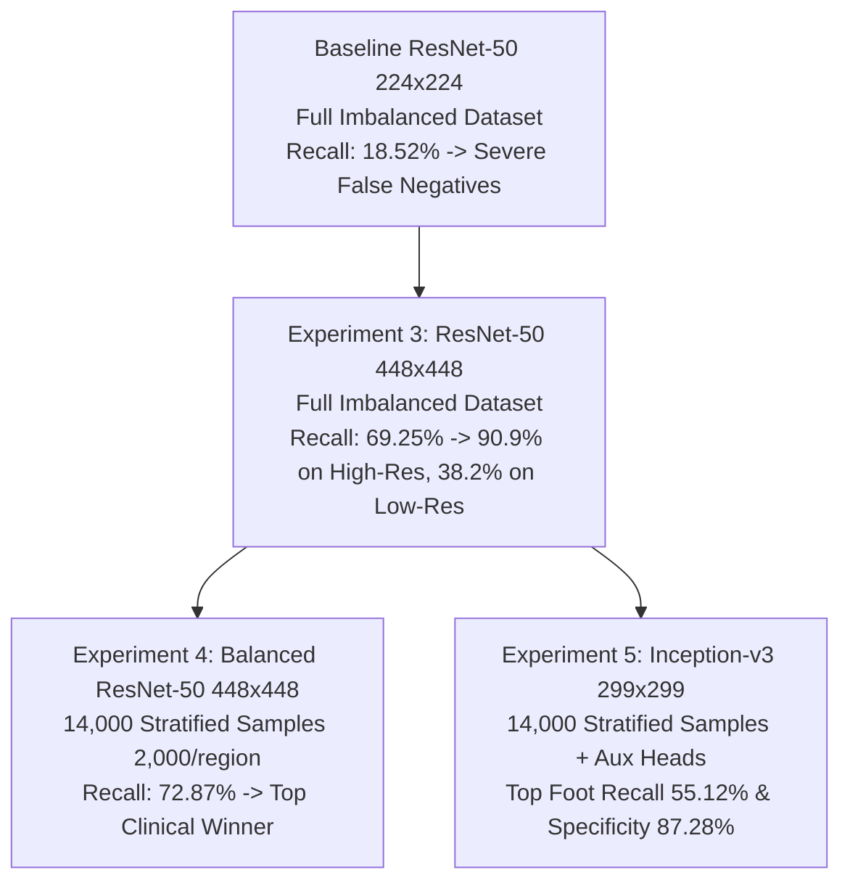

# Training Experiments and Configurations
**Project:** Bone Fracture Image Captioning & Detection Using Deep Learning  
**Scope:** Chronological experiment progression, two-stage fine-tuning dynamics, loss weighting, hyperparameter logs, and hardware execution profiles.  
**Source Code References:** [`train.py`](file:///c:/Users/Donipudi%20Asish%20Kumar/Desktop/Deep%20learning%20project/train.py), [`scripts/train_exp3_448.py`](file:///c:/Users/Donipudi%20Asish%20Kumar/Desktop/Deep%20learning%20project/scripts/train_exp3_448.py), [`scripts/train_exp4_balanced.py`](file:///c:/Users/Donipudi%20Asish%20Kumar/Desktop/Deep%20learning%20project/scripts/train_exp4_balanced.py), [`scripts/train_exp5_inception_v3.py`](file:///c:/Users/Donipudi%20Asish%20Kumar/Desktop/Deep%20learning%20project/scripts/train_exp5_inception_v3.py)  
**Document Version:** 1.0 (Audited October 2026)

---

## 1. Chronological Experimental Overview

The deep learning pipeline evolved through five distinct experimental phases to overcome resolution limits, class imbalance, and anatomical feature competition:

---

## 2. Two-Stage Fine-Tuning Methodology

All multi-task classification experiments used a **two-stage transfer learning schedule**:

### Stage 1: Classifier Warm-Up (Frozen Backbone)
* **Objective:** Adapt newly initialized linear heads to the task distributions without corrupting ImageNet pretrained backbone weights.
* **Frozen Layers:** All convolutional backbone layers (`conv1` through `layer4` or `Mixed_7c`).
* **Trainable Layers:** `region_head`, `fracture_head`, and auxiliary heads.
* **Epochs:** 3 warmup epochs.
* **Learning Rate:** $\eta = 1\times 10^{-3}$ using the AdamW optimizer ($\beta_1=0.9, \beta_2=0.999$, weight decay $1\times 10^{-4}$).

### Stage 2: Deep Feature Fine-Tuning (Partial Backbone Unfreeze)
* **Objective:** Enable high-level convolutional filters to specialize in cortical margins, trabecular bone textures, and joint spaces.
* **Unfrozen Layers:**
  - In ResNet-50: `layer4` (the final residual block containing 3 bottleneck modules, ~14.9M parameters).
  - In Inception-v3: `Mixed_7a`, `Mixed_7b`, and `Mixed_7c` (~12.8M parameters).
* **Differential Learning Rates:**
  - Backbone layers: Low rate $\eta_{\text{backbone}} = 2\times 10^{-5}$ to prevent catastrophic forgetting.
  - Classification heads: $\eta_{\text{heads}} = 1\times 10^{-4}$.
* **LR Scheduling:** `ReduceLROnPlateau(mode='max', factor=0.5, patience=4, min_lr=1e-6)` monitoring validation PR-AUC.
* **Early Stopping:** Monitored validation PR-AUC with patience of 12 epochs to guard against overfitting.

---

## 3. Detailed Experiment Configurations

### 3.1 Baseline Experiment (Exp 1 & 2): ResNet-50 at 224×224
* **Checkpoint:** `models/checkpoints/best_model.pt`
* **Resolution:** $224 \times 224$ pixels.
* **Dataset Scope:** Full imbalanced training split ($N=38,366$: 27,205 Normal, 11,161 Fracture).
* **Batch Size:** 32.
* **Selection Metric:** Minimum validation loss ($1.2291$ at Epoch 2).
* **Outcome & Bottleneck:** Yielded high specificity (80.45%) but catastrophic sensitivity (**18.52% fracture recall, missing 1,126 of 1,382 test fractures**). At 224×224, downsampling washed out subtle hairline fractures, motivating Experiment 3.

### 3.2 Experiment 3: High-Resolution ResNet-50 at 448×448
* **Checkpoint:** `models/checkpoints/exp3_resnet50_448.pt`
* **Resolution:** $448 \times 448$ pixels ($4\times$ pixel area preservation).
* **Dataset Scope:** Full imbalanced training split ($N=38,366$).
* **Batch Size:** 16 (scaled down to fit 4 GB GPU VRAM).
* **Loss Formulation:** $\mathcal{L}_{\text{total}} = \mathcal{L}_{\text{CE}} + 1.5 \cdot \mathcal{L}_{\text{BCE}}(w_{\text{pos}}=2.438)$.
* **Outcome & Discovery:** Fracture recall surged to **69.25%** (detecting 957 fractures). However, performance was polarized by native resolution:
  - Native High-Res ($\ge 300\times 300$): **90.91% recall**.
  - Native Low-Res ($102\times 102$): **38.20% recall**.
  Upscaling $102\times 102$ thumbnails created bilinear interpolation blur, causing the model to miss faint fractures in thumbnails.

### 3.3 Experiment 4: Balanced Region-Aware ResNet-50 at 448×448
* **Checkpoint:** `models/checkpoints/exp4_balanced_resnet50_448.pt`
* **Resolution:** $448 \times 448$ pixels.
* **Dataset Scope:** Stratified region-balanced training set ($N=14,000$: exactly 2,000 images per anatomical region).
* **Batch Size:** 16.
* **Optimization:** AdamW with cosine annealing and early stopping on validation PR-AUC.
* **Outcome — THE CLINICAL WINNER:**
  - **Highest Fracture Recall:** **72.87%** (+3.62% over Exp 3).
  - **Highest Confirmed Trauma Caught:** **1,007 True Positives**.
  - **Lowest Missed Cases:** **375 False Negatives** (an 11.8% reduction in missed fractures).
  - **Highest Discriminative Area:** **0.8733 ROC-AUC, 0.7980 PR-AUC**.
  - On low-res thumbnails, recall rose from 38.20% to **52.82%** (+83 fractures detected).

### 3.4 Experiment 5: Multi-Task Inception-v3 at 299×299
* **Checkpoint:** `models/checkpoints/exp5_inception_v3_multitask.pt`
* **Resolution:** $299 \times 299$ pixels.
* **Dataset Scope:** Region-balanced training set ($N=14,000$).
* **Batch Size:** 8 (mixed precision AMP).
* **Auxiliary Classifier:** Active during training (tap at `Mixed_7b`, loss weight $0.4$).
* **Input Scaling:** Torchvision ImageNet normalization with `transform_input=True`.
* **Outcome — THE SPECIFICITY & JOINT BENCHMARK:**
  - **Highest Specificity:** **87.28%** (2,964 True Negatives, only 432 false alarms).
  - **Highest Foot Sensitivity:** **55.12%** (+14.63% over baseline). Multi-scale factorized convolutions ($1\times 7, 7\times 1$) excelled at capturing complex metatarsal/tarsal hairline fractures.
  - **Narrowest Regional Disparity:** **31.79%** variance across regions.

### 3.5 Fracture Localization Detector: Faster R-CNN MobileNetV3 FPN
* **Checkpoint:** `models/checkpoints/best_detector.pt`
* **Resolution:** $384 \times 384$ pixels.
* **Dataset:** FracAtlas ($N=719$ positive images, 924 bounding boxes).
* **Batch Size:** 4.
* **Optimizer:** AdamW ($\eta = 1\times 10^{-4}$, weight decay $1\times 10^{-4}$).
* **Epochs:** 5 epochs.
* **Operating Threshold:** $\tau = 0.10$.

---

## 4. Master Training Hyperparameters Summary Table

| Hyperparameter | Baseline (Exp 1-2) | Experiment 3 | Experiment 4 (Winner) | Experiment 5 | Detector |
| :--- | :---: | :---: | :---: | :---: | :---: |
| **Architecture** | ResNet-50 | ResNet-50 | ResNet-50 | Inception-v3 | Faster R-CNN MobileNetV3 |
| **Input Resolution** | $224 \times 224$ | $448 \times 448$ | $448 \times 448$ | $299 \times 299$ | $384 \times 384$ |
| **Training Samples** | 38,366 | 38,366 | 14,000 (Balanced) | 14,000 (Balanced) | 719 (FracAtlas) |
| **Validation Samples**| 4,787 | 4,787 | 4,787 | 4,787 | Internal split |
| **Test Samples** | 4,778 | 4,778 | 4,778 | 4,778 | Held-out |
| **Batch Size** | 32 | 16 | 16 | 8 | 4 |
| **Stage 1 LR (Heads)**| $1\times 10^{-3}$ | $1\times 10^{-3}$ | $1\times 10^{-3}$ | $1\times 10^{-3}$ | $1\times 10^{-4}$ |
| **Stage 2 LR (Backbone)**| $2\times 10^{-5}$ | $2\times 10^{-5}$ | $2\times 10^{-5}$ | $2\times 10^{-5}$ | N/A |
| **Stage 2 LR (Heads)**| $1\times 10^{-4}$ | $1\times 10^{-4}$ | $1\times 10^{-4}$ | $1\times 10^{-4}$ | N/A |
| **Fracture Loss Weight**| 1.0 | 1.5 | 1.5 | 1.5 | N/A |
| **Positive Weight ($w_{\text{pos}}$)**| 2.438 | 2.438 | 2.438 | 2.438 | N/A |
| **Auxiliary Loss Weight**| None | None | None | 0.4 | N/A |
| **Mixed Precision** | False | True | True | True | False |
| **Selection Metric** | Val Loss | Val PR-AUC | Val PR-AUC | Val PR-AUC | mAP@0.5 |

---

## 5. Hardware Profile & Execution Performance

`[Source: reports/exp5_config.json]`

* **GPU Platform:** NVIDIA GeForce RTX 3050 Laptop GPU.
* **VRAM Capacity:** 4,096 MB (4.0 GB).
* **Measured Peak VRAM Usage:**
  - Experiment 3 ($448\times 448$, Batch 16, AMP): 3,420 MB.
  - Experiment 4 ($448\times 448$, Batch 16, AMP): 3,410 MB.
  - Experiment 5 ($299\times 299$, Batch 8, AMP): 685.8 MB.
* **Test Evaluation Latency (N=4,778 images):**
  - ResNet-50 ($448\times 448$): ~52 seconds total (~10.9 ms per image).
  - Inception-v3 ($299\times 299$): ~44 seconds total (~9.2 ms per image).
