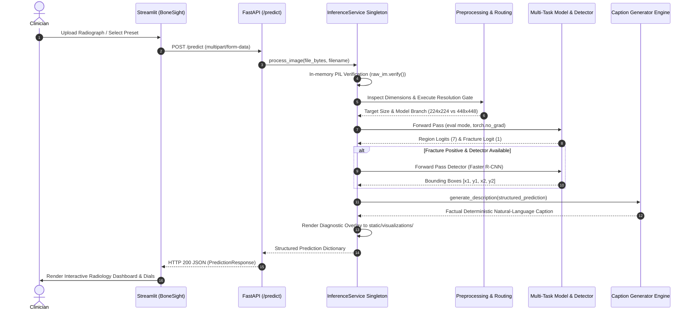

# Inference, Captioning, and Application Architecture
**Project:** Bone Fracture Image Captioning & Detection Using Deep Learning  
**Scope:** End-to-end prediction execution trace, resolution routing, deterministic clinical caption generation rules, FastAPI REST API, and Streamlit diagnostic UI.  
**Source Code References:** [`backend/main.py`](file:///c:/Users/Donipudi%20Asish%20Kumar/Desktop/Deep%20learning%20project/backend/main.py), [`backend/services/inference_service.py`](file:///c:/Users/Donipudi%20Asish%20Kumar/Desktop/Deep%20learning%20project/backend/services/inference_service.py), [`src/caption_generator.py`](file:///c:/Users/Donipudi%20Asish%20Kumar/Desktop/Deep%20learning%20project/src/caption_generator.py), [`frontend/app.py`](file:///c:/Users/Donipudi%20Asish%20Kumar/Desktop/Deep%20learning%20project/frontend/app.py)  
**Document Version:** 1.0 (Audited October 2026)

---

## 1. End-to-End Prediction Execution Trace

The execution sequence traces an uploaded radiograph through validation, dynamic resolution routing, neural inference, factual captioning, and presentation:



### Trace Details:
1. **Input Acquisition & Memory Validation:**  
   Uploaded byte payloads are validated in-memory via `PIL.Image.open(io.BytesIO(file_bytes))` and `raw_im.verify()`. Corrupted payloads or non-image files return an immediate `HTTP 400 Bad Request` without allocating GPU memory.
2. **Resolution-Aware Routing Gate:**  
   `ModelRegistry.route_image(width, height)` inspects raw image dimensions:
   - If $\min(\text{width}, \text{height}) \ge 300\text{ px}$: Routes to the high-resolution pipeline ($448 \times 448$, `exp3_resnet50_448.pt`).
   - If $\min(\text{width}, \text{height}) < 300\text{ px}$: Routes to the baseline pipeline ($224 \times 224$, `best_model.pt`).
3. **Deterministic Preprocessing:**  
   The image is padded with aspect-ratio preservation to target square dimensions on a black canvas and normalized.
4. **Multi-Task Prediction:**  
   The network generates 7-class anatomical region logits (Softmax) and 1 binary fracture logit (Sigmoid). If predicted region confidence is below $\tau_{\text{unc}} = 0.40$, an `uncertain_anatomy` flag is raised.
5. **Spatial Localization:**  
   If fracture probability $\ge 0.50$, the Faster R-CNN detector evaluates the radiograph at $384 \times 384$. Bounding boxes with confidence $\ge 0.10$ are rescaled to original image dimensions.
6. **Caption Synthesis:**  
   The structured findings are passed to `generate_description()`, which constructs a factual caption adhering to 10 clinical safety rules.
7. **Serialization & Presentation:**  
   The structured output is validated via Pydantic `PredictionResponse` and rendered in Streamlit.

---

## 2. Disciplined Factual Caption Generation Subsystem

`[Source: src/caption_generator.py & reports/caption_generator_audit.md]`

### 2.1 Clinical Motivation & Hallucination Elimination
In healthcare AI, generative natural language models (e.g., LSTMs, Transformers, Large Multimodal Models) frequently **hallucinate unsupported clinical claims**, such as inventing trauma mechanisms ("patient fell from ladder"), fracture subtypes ("severe comminuted spiral fracture"), or treatment recommendations ("immediate surgical fixation").

To guarantee clinical safety, the caption subsystem uses a **deterministic, rule-governed synthesis engine** bounded strictly by confirmed computer vision findings.

### 2.2 The 10 Clinical Safety Rules
1. **Strict Information Boundary:** Uses *only* verified structured outputs (`anatomical_region`, `fracture_status`, `confidence`, `location`).
2. **Zero Subtype Hallucination:** Never generates unsupported fracture subtypes (e.g., transverse, spiral, comminuted, hairline).
3. **Zero Displacement Hallucination:** Never infers displacement (e.g., displaced, non-displaced, angulated).
4. **Zero Severity Hallucination:** Never invents severity terms (e.g., acute, mild, severe, catastrophic).
5. **Zero Demographics:** Never invents patient age, sex, or background.
6. **Zero Trauma Mechanisms:** Never infers how the injury occurred (e.g., FOOSH, collision, sports).
7. **Zero Treatment Directives:** Never prescribes medical treatments (e.g., cast, splint, surgery).
8. **No Unqualified Diagnostic Claims:** Descriptions clearly state findings are "detected by the model", never claiming to be an authoritative clinician diagnosis.
9. **Deterministic Syntactic Rules:** Equivalent input inputs always produce byte-for-byte identical text.
10. **Concise Medical Phrasing:** Produces standard radiological impression statements.

### 2.3 Exact Template Assembly Mapping

```python
# Rule 1: No fracture detected
if not is_fracture:
    if region:
        return f"X-ray of the {region} with no fracture detected by the model."
    return "X-ray with no fracture detected by the model."

# Rule 2: Fracture detected with validated anatomical location
if location:
    if region:
        return f"X-ray of the {region} showing a fracture involving the {location}."
    return f"X-ray showing a fracture involving the {location}."

# Rule 3: Fracture detected without validated sub-location
if region:
    return f"X-ray of the {region} with a fracture detected by the model."
return "X-ray with a fracture detected by the model."
```

### Verified Examples:
- Input: `{"anatomical_region": "wrist", "fracture": False}`  
  $\rightarrow$ `"X-ray of the wrist with no fracture detected by the model."`
- Input: `{"anatomical_region": "wrist", "fracture": True}`  
  $\rightarrow$ `"X-ray of the wrist with a fracture detected by the model."`
- Input: `{"anatomical_region": "wrist", "fracture": True, "fracture_location": "distal radius"}`  
  $\rightarrow$ `"X-ray of the wrist showing a fracture involving the distal radius."`

---

## 3. Backend REST Microservice (FastAPI)

`[Source: backend/main.py & backend/schemas.py]`

The backend is built with FastAPI, providing an asynchronous, production-ready REST service.

### 3.1 API Endpoints
* **`GET /health`:** Liveness and readiness probe.
  - Response: `{"status": "ok"}` (HTTP 200).
* **`POST /predict`:** Core diagnostic endpoint.
  - Ingestion: Multipart form data (`image: UploadFile`).
  - Response Model: `PredictionResponse`.
  - HTTP Status Codes:
    - `200 OK`: Successful analysis.
    - `400 Bad Request`: Corrupted, unreadable, or non-image file payload.
    - `500 Internal Server Error`: Unhandled inference execution error.
    - `503 Service Unavailable`: Model weights not loaded or memory exhausted.
* **`GET /visualizations/{filename}`:** Secure file server delivering annotated diagnostic overlays. Includes path-traversal protection (`os.path.basename` validation).

### 3.2 Pydantic Data Contracts (`backend/schemas.py`)
```python
class BoundingBoxSchema(BaseModel):
    box_2d: List[float] = Field(..., description="[ymin, xmin, ymax, xmax] normalized or [x1, y1, x2, y2] native")
    confidence: float
    label: str

class PredictionResponse(BaseModel):
    success: bool = True
    anatomical_region: Optional[str]
    region_confidence: Optional[float]
    fracture_detected: bool
    fracture_probability: float
    operating_threshold: float = 0.50
    caption: str
    uncertain_anatomy: bool = False
    localization_available: bool = False
    localization: Optional[List[BoundingBoxSchema]] = None
    visualization_url: Optional[str] = None
    execution_time_ms: Optional[float] = None
```

---

## 4. Frontend Clinical Dashboard (*BoneSight*)

`[Source: frontend/app.py]`

The frontend is a dedicated clinical diagnostic dashboard built in Streamlit (1,338 lines) using a custom medical design system.

### 4.1 Visual Design System
- **Theme Palette:** Medical Navy (`#123B5D`), Steel Teal (`#1F6F8B`), Soft Clinical Slate (`#F5F8FA`), Signal Alert Red (`#E63946`), Confidence Emerald (`#2A9D8F`).
- **Typography:** Professional clean sans-serif system stack (Inter, -apple-system, BlinkMacSystemFont, Segoe UI).
- **Safe DOM Rendering:** All custom HTML components use `render_html()` which strips leading indentations, preventing Markdown parser glitches.

### 4.2 Interactive Diagnostic Capabilities
1. **Interactive Preset Loaders:** One-click preloading of genuine clinical radiographs across diverse anatomical sites (`Hand`, `Foot`, `Wrist`, `Thigh`).
2. **DICOM Contrast Inversion:** Live client-side photometric inversion toggle (standard black-on-white vs. white-on-black) aiding detection of subtle cortical hairline cracks.
3. **Calibrated Confidence Dials:** Visual gauge displaying calibrated fracture probability against the $0.50$ clinical operating threshold.
4. **Top-3 Anatomical Region Probabilities:** Interactive bar chart displaying regional classification confidence and flagging anatomical uncertainty if confidence $< 0.40$.
5. **Factual Summary Card:** Direct rendering of the disciplined clinical caption with clear provenance labeling.
6. **Raw JSON Inspector:** Full transparency view allowing radiologists to inspect raw API response dictionaries.
7. **Clinical Report Export:** Instant export of diagnostic findings for patient records.

---

## 5. Deployment and Operational Commands

### 5.1 Starting the Complete Platform
In Terminal 1 (Backend API):
```powershell
.venv\Scripts\activate
uvicorn backend.main:app --host 127.0.0.1 --port 8000
```

In Terminal 2 (Streamlit UI):
```powershell
.venv\Scripts\activate
streamlit run frontend/app.py --server.port 8501
```

### 5.2 Environment Variable Overrides
Configuration parameters can be tuned via `.env`:
* `CLASSIFIER_CHECKPOINT`: Custom path to primary classifier weights.
* `DETECTOR_CHECKPOINT`: Custom path to Faster R-CNN weights.
* `FRACTURE_THRESHOLD`: Binary decision threshold (default: `0.50`).
* `BACKEND_URL`: URL used by Streamlit to reach FastAPI (default: `http://127.0.0.1:8000`).
