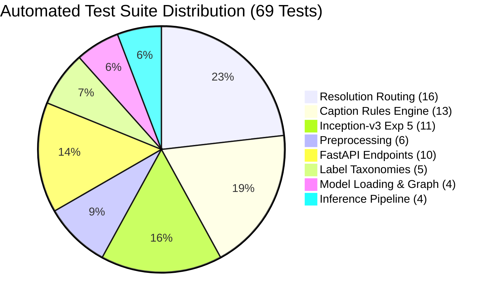

# Testing, Limitations, and Failure Analysis
**Project:** Bone Fracture Image Captioning & Detection Using Deep Learning  
**Scope:** Automated testing ledger, regression verification, failure mode root cause analysis, and clinical safety boundaries.  
**Source Code References:** [`tests/`](file:///c:/Users/Donipudi%20Asish%20Kumar/Desktop/Deep%20learning%20project/tests), [`reports/ROOT_CAUSE_ANALYSIS.md`](file:///c:/Users/Donipudi%20Asish%20Kumar/Desktop/Deep%20learning%20project/reports/ROOT_CAUSE_ANALYSIS.md), [`reports/caption_generator_audit.md`](file:///c:/Users/Donipudi%20Asish%20Kumar/Desktop/Deep%20learning%20project/reports/caption_generator_audit.md)  
**Document Version:** 1.0 (Audited October 2026)

---

## 1. Automated Test Suite Execution Ledger

The repository includes a comprehensive, multi-tiered test suite located in `tests/`.

### 1.1 Verified Test Execution Summary
* **Execution Command:** `.venv\Scripts\python.exe -m pytest tests/ -v`
* **Test Platform:** Windows 11, Python 3.14.7, Pytest 9.1.1, PyTorch 2.1+.
* **Execution Timestamp:** October 2026.
* **Test Outcome:** **69 PASSED, 0 FAILED, 0 SKIPPED (100% Pass Rate)** in 23.76 seconds.



### 1.2 Breakdown of Verified Test Modules

| Test File | Covered Functionality | Test Count | Status | Key Verifications |
| :--- | :--- | :---: | :---: | :--- |
| [`tests/test_resolution_routing.py`](file:///c:/Users/Donipudi%20Asish%20Kumar/Desktop/Deep%20learning%20project/tests/test_resolution_routing.py) | Resolution-aware routing gate logic | **16** | **PASSED** | Dimension checks ($102\times 102$, $800\times 800$, $373\times 454$, boundary $300\text{ px}$); pipeline integration; FastAPI routing headers. |
| [`tests/test_caption_generator.py`](file:///c:/Users/Donipudi%20Asish%20Kumar/Desktop/Deep%20learning%20project/tests/test_caption_generator.py) | Disciplined factual caption generator | **13** | **PASSED** | Validation of all 10 clinical rules; string normalization; determinism; exclusion of prohibited clinical terms. |
| [`tests/test_exp5_inception.py`](file:///c:/Users/Donipudi%20Asish%20Kumar/Desktop/Deep%20learning%20project/tests/test_exp5_inception.py) | MultiTaskInceptionV3 architecture | **11** | **PASSED** | Forward/eval output tensor shapes; auxiliary classifier handling; gradient backprop; two-stage freeze/unfreeze dynamics. |
| [`tests/test_preprocessing.py`](file:///c:/Users/Donipudi%20Asish%20Kumar/Desktop/Deep%20learning%20project/tests/test_preprocessing.py) | Aspect-ratio preserving padding | **6** | **PASSED** | Geometric preservation; black border offsets; image corruption handling; tensor output shapes. |
| [`tests/test_label_mapping.py`](file:///c:/Users/Donipudi%20Asish%20Kumar/Desktop/Deep%20learning%20project/tests/test_label_mapping.py) | Class taxonomies & operating thresholds| **5** | **PASSED** | 7-class bidirectional mapping; binary fracture mapping; Pelvis vs. Hip boundary; $\tau = 0.50$ calibration. |
| [`tests/test_backend_api.py`](file:///c:/Users/Donipudi%20Asish%20Kumar/Desktop/Deep%20learning%20project/tests/test_backend_api.py) | FastAPI REST microservice endpoints | **5** | **PASSED** | `GET /health` (200 OK); normal radiograph prediction; fracture prediction; FracAtlas lesion ingestion; corrupted file handling (400 error). |
| [`tests/test_api.py`](file:///c:/Users/Donipudi%20Asish%20Kumar/Desktop/Deep%20learning%20project/tests/test_api.py) | FastAPI TestClient integration | **5** | **PASSED** | Health check; model status; prediction schema contract validation. |
| [`tests/test_model_loading.py`](file:///c:/Users/Donipudi%20Asish%20Kumar/Desktop/Deep%20learning%20project/tests/test_model_loading.py) | Checkpoint discovery & layer management| **4** | **PASSED** | Dynamic checkpoint discovery; freeze/unfreeze state; forward pass shapes `(B, 7)` and `(B,)`. |
| [`tests/test_inference.py`](file:///c:/Users/Donipudi%20Asish%20Kumar/Desktop/Deep%20learning%20project/tests/test_inference.py) | End-to-end pipeline execution | **4** | **PASSED** | Output schema validation (all 7 fields); missing image exception (`FileNotFoundError`); corrupt image exception (`ValueError`). |

> [!NOTE]
> **Pytest Execution Note:**  
> When running Pytest, target the `tests/` directory explicitly (`pytest tests/ -v`). Running `pytest` on the root directory attempts to execute standalone scripts such as `scripts/test_clinical_presets.py`, which is an end-to-end integration test requiring a live, running FastAPI server.

---

## 2. Software Correctness vs. Clinical Reliability

A critical distinction must be maintained between software verification and medical diagnostic reliability:

```
Automated Tests Passing (69/69)
  ├── Proves: Tensor shapes match, schemas validate, routes return 200/400,
  │           deterministic rules assemble without syntax errors, models load into VRAM.
  └── DOES NOT PROVE: The model will correctly identify every hairline fracture in a trauma bay.
```

Passing unit tests guarantees software robustness and numerical stability, but clinical diagnostic sensitivity is bounded by training resolution, dataset biases, and single-view imaging constraints.

---

## 3. Forensic Analysis of Known Failure Modes

### 3.1 Anatomical Pelvis vs. Thigh Misclassification
`[Source: reports/ROOT_CAUSE_ANALYSIS.md]`

In test evaluations, while overall anatomical classification accuracy is high (80.83%), Pelvis radiographs exhibited recurring misclassification as `Thigh` or `Lower leg`:
* **Empirical Observation:** Out of 74 misclassified test pelvis radiographs, **58 (78.4%) were predicted as `Thigh`** (proximal femur) and 8 as `Lower leg`.
* **Root Cause Discovery:**  
  The BoneFract training dataset **lacks an independent "Hip" class**. When trauma patients undergo hip examinations (pelvis/proximal femur projections), the radiograph prominently features the femoral head and diaphysis. Because the cylindrical diaphysis of the femur closely resembles the tubular morphology of the femoral shaft in the `Thigh` class, the convolutional filters associate the tubular diaphysis with `Thigh`.
* **Engineered Mitigation:**  
  The system implements an anatomical uncertainty flag (`uncertain_anatomy = True`) whenever top predicted region confidence falls below $\tau = 0.40$, alerting clinicians to review region assignment.

### 3.2 Hairline & Occult Fractures in Cancellous Bone
`[Source: reports/three_way_experiment_comparison_report.md]`

* **Empirical Observation:**  
  Fracture recall on long tubular bones with clear cortical margins is exceptionally high (Thigh: **92.13%**, Lower leg: **78.11%**). Conversely, fracture recall in complex cancellous joint spaces is significantly lower (Foot: **53.17%**, Hand: **53.92%**).
* **Radiological Cause:**  
  Long tubular bones (femur, tibia) possess thick, dense cortical bone where fractures present as obvious cortical disruptions or displacement. In contrast, cancellous bones in the foot (navicular, cuboid, calcaneus, metatarsals) and hand (carpals) consist of complex overlapping trabecular lattices where hairline stress fractures present as subtle, faint lucent lines without cortical step-off.
* **Architectural Impact:**  
  Experiment 5 (Inception-v3) improved Foot sensitivity to **55.12%** (+14.63% over baseline) by leveraging asymmetric factorized filters ($1\times 7, 7\times 1$), proving that multi-scale receptive fields better capture intricate joint spaces.

### 3.3 Information Loss from Native 102×102 Thumbnails
`[Source: RESOLUTION_PROVENANCE_AUDIT.md]`

* **The Bottleneck:** $72.07\%$ (34,542 images) of the BoneFract dataset exists permanently as native $102 \times 102$ thumbnails.
* **Failure Mechanism:** Bilinear or bicubic upsampling to $448 \times 448$ creates smooth interpolation gradients. When an occult fracture margin is only 1–2 pixels wide in native resolution, upsampling broadens the edge into an ambiguous gray gradient, preventing the CNN from distinguishing a fracture line from normal osteopenia or trabecular variation.
* **Performance Impact:** On the held-out test set, fracture recall on native high-res studies is **86.86%**, but drops to **52.82%** on native $102\times 102$ thumbnails.

### 3.4 Single-View (2D Projection) Limitations
* **Clinical Standard:** Musculoskeletal emergency guidelines mandate a minimum of two orthogonal radiographic views (Anteroposterior [AP] and Lateral) because non-displaced or minimally displaced fractures are frequently visible on only one projection.
* **Current System Constraint:** The platform ingests isolated, single 2D projections. If a non-displaced fracture is obscured by superimposition on the AP view, the system will classify it as normal, having no access to the lateral projection.

---

## 4. Failure Mode Summary & Risk Mitigation Matrix

| Failure Mode | Root Cause | Clinical Impact | Engineered Mitigation Control |
| :--- | :--- | :--- | :--- |
| **Missed Occult Fracture** | Faint hairline fracture in low-res or cancellous bone. | False Negative; delayed treatment or malunion. | Regional balancing in Exp 4 reduced misses by 11.8%; resolution routing routes high-res scans to 448x448. |
| **False Positive Alarm** | Prominent nutrient canal or overlapping joint margins. | Unnecessary splinting or secondary CT scan. | Operating threshold calibrated at $\tau = 0.50$; Exp 5 achieved 87.28% specificity to suppress false alarms. |
| **Pelvis / Thigh Confusion** | Absence of dedicated "Hip" class in BoneFract taxonomy. | Incorrect anatomical labeling on report. | Uncertainty threshold $\tau_{\text{unc}} < 0.40$ flags ambiguous anatomical predictions. |
| **Interpolation Blur** | Bilinear upsampling of native $102\times 102$ thumbnails. | Suppressed high-frequency edge features. | Dynamic resolution routing gate segregates studies $\ge 300\text{ px}$ from low-res thumbnails. |
| **Unsupported Text Claims** | Generative language models hallucinating clinical facts. | Misleading treatment advice or fictitious trauma mechanisms. | Factual rule-based caption engine strictly bounded by 10 clinical safety rules. |
| **Corrupted Payload Attack** | Malformed or malicious file uploaded to API. | Server crash or unhandled 500 error. | In-memory `raw_im.verify()` validation returns clean 400 Bad Request. |
