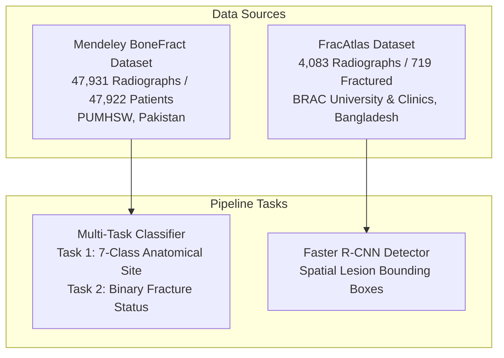
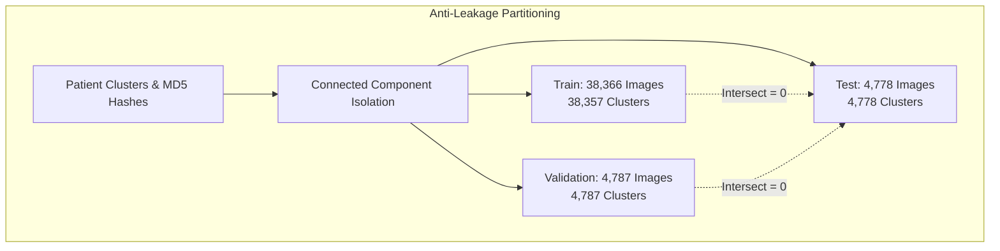

# 03. Dataset Acquisition, Provenance, and Data Collection

**Project Title:** Bone Fracture Image Captioning Using Deep Learning  
**Scope:** Forensic dataset audit, source licensing, image formats, resolution distribution, bipartite graph partitioning, anti-leakage verification, and region-balanced sampling manifests.  
**Primary Datasets:** Mendeley BoneFract & Nature FracAtlas  
**Document Version:** 1.0 (Audited October 2026)  

---

## 1. Primary Datasets Overview

The project relies on two distinct clinical radiographic datasets, each mapped to a specific technical task:

---

## 2. Dataset 1: Mendeley BoneFract

### 2.1 Bibliographic & Administrative Details
* **Official Dataset Title:** BoneFract: A Bone Fracture Dataset
* **Contributing Institution:** Peoples University of Medical and Health Sciences for Women (PUMHSW), Nawabshah, Shaheed Benazirabad, Sindh, Pakistan.
* **Publication Platform:** Mendeley Data (Elsevier).
* **Dataset Version:** Version 1 (Published 2023).
* **Persistent Identifier / DOI:** `doi:10.17632/jhqrxmff7v.1`
* **Direct Access URL:** [https://data.mendeley.com/datasets/jhqrxmff7v/1](https://data.mendeley.com/datasets/jhqrxmff7v/1)
* **License:** Creative Commons Attribution 4.0 International (CC BY 4.0). Permits unrestricted academic and commercial sharing, transformation, and adaptation with appropriate attribution.
* **Original Compressed Archive:** `BoneFract A Bone Fracture Dataset.zip` (3.25 GB compressed; expands to ~3.95 GB).

### 2.2 Anatomical Scope & Class Definitions
The dataset catalogs standard clinical plain radiographs across **7 anatomical sites**:
1. `Arm`: Humerus, radius, and ulna projections.
2. `Foot`: Tarsal, metatarsal, and phalangeal projections.
3. `Hand`: Carpal, metacarpal, and phalangeal projections.
4. `Lower leg`: Tibial and fibular projections.
5. `Thigh`: Femoral diaphysis and shaft projections.
6. `pelvis`: Pelvic girdle, sacroiliac joints, acetabulum, and proximal femoral head projections.
7. `wrist`: Distal radius, distal ulna, and proximal carpal row projections.

> [!IMPORTANT]
> **Taxonomy Boundary Note on Pelvis vs. Hip:**  
> The BoneFract dataset does **not possess an independent "Hip" class**. Radiographs of the hip joint, acetabulum, and femoral neck are cataloged under `pelvis` (or proximal femoral shaft under `Thigh`). This taxonomy design is the primary contributor to anatomical confusion for hip examinations.

### 2.3 Image Formats, Color Space, and Dimensions
* **Total Curated Images:** 47,931 plain radiographs.
* **Unique Patient Identifiers:** 47,922 unique patient clusters (`patientXXXXX`).
* **Image Format:** PNG (lossless compression).
* **Color Channels:** 8-bit single-channel grayscale (`mode='L'`), broadcast across 3 identical RGB channels upon tensor loading.
* **Resolution Profile (Bimodal):**
  - **Native Low-Resolution Cohort:** Exactly $102 \times 102$ pixels (**34,542 images; 72.07%**).
  - **Diagnostic High-Resolution Cohort:** Dimensions ranging from $300 \times 300$ up to $1920 \times 876$ pixels (**13,389 images; 27.93%**).

---

## 3. Forensic Discovery: Provenance of the Native 102×102 Images

During early experiments (Experiment 3), upscaling raw images to $448 \times 448$ resulted in poor fracture sensitivity on low-resolution images (38.20% recall), despite achieving 90.91% recall on high-resolution images. A forensic audit was initiated ([`scripts/audit_resolution_provenance.py`](file:///c:/Users/Donipudi%20Asish%20Kumar/Desktop/Deep%20learning%20project/scripts/audit_resolution_provenance.py)) to determine whether the $102 \times 102$ images were compressed thumbnails of higher-resolution scans or native images.

### Forensic Audit Findings ([`RESOLUTION_PROVENANCE_AUDIT.md`](file:///c:/Users/Donipudi%20Asish%20Kumar/Desktop/Deep%20learning%20project/RESOLUTION_PROVENANCE_AUDIT.md)):
1. **Native Origin:** The $102 \times 102$ images were ingested natively from PUMHSW's hospital capture systems as low-resolution exports.
2. **Zero Missing High-Res Originals:** Forensic inspection of the full 3.25 GB distribution archive verified that no alternative high-resolution counterparts exist for this 72.07% cohort.
3. **Disjoint Patient Populations:** Perceptual hash (pHash) analysis and patient ID clustering proved that the low-resolution and high-resolution cohorts represent completely distinct patient visits from different imaging units.
4. **Architectural Consequence:** Bilinear upsampling of native $102 \times 102$ images creates artificial edge blur. This necessitated the implementation of the **dynamic resolution routing gate** in `inference/model_registry.py`.

---

## 4. Dataset 2: Nature FracAtlas

### 4.1 Bibliographic & Administrative Details
* **Official Dataset Title:** FracAtlas: A Dataset for Bone Fracture Classification, Detection and Segmentation
* **Contributing Authors:** Iftekhar et al. (Department of CSE, BRAC University, Bangladesh, in collaboration with national medical institutes).
* **Publication Venue:** *Nature Scientific Data* (Vol. 10, Article 586, Published 2023).
* **Identifier / DOI:** `doi:10.1038/s41597-023-02432-4`
* **Direct Access URL:** [https://figshare.com/articles/dataset/22634356](https://figshare.com/articles/dataset/22634356)
* **License:** Creative Commons Attribution 4.0 International (CC BY 4.0).
* **Storage Location:** `data/FracAtlas/`

### 4.2 Annotation Scope & Bounding Boxes
* **Total Radiographs:** 4,083 images.
* **Positive Fracture Cases:** 719 radiographs containing **924 expert-annotated lesion bounding boxes**.
* **Annotation Formats:** COCO JSON (`COCO_fracture_masks.json`) and Pascal VOC XML bounding box representations.
* **Role in System:** Used exclusively to train and validate the **Faster R-CNN MobileNetV3-Large FPN detector** (`models/checkpoints/best_detector.pt`).

---

## 5. Patient-Level Graph Partitioning Protocol (Anti-Leakage)

### 5.1 The Contamination Vulnerability
In clinical computer vision, partitioning datasets randomly by image file introduces **severe data leakage**: multiple radiographs of the same patient or duplicate uploads end up in both training and test sets, artificially inflating reported test performance.

### 5.2 Bipartite Graph Partitioning Algorithm
To guarantee zero data contamination, the project implemented an automated graph-connected component partitioning protocol ([`preprocess.py`](file:///c:/Users/Donipudi%20Asish%20Kumar/Desktop/Deep%20learning%20project/preprocess.py), `cluster_and_partition()`):
1. **Graph Construction:** Formulate an undirected bipartite graph $G = (V, E)$ where vertices represent patient IDs and exact MD5 file hashes.
2. **Edge Formation:** An edge connects a patient identifier to an image hash if that patient was imaged in that file.
3. **Connected Components:** Extract connected subgraphs $\{C_1, C_2, \dots, C_k\}$. All images belonging to a single connected component share identical or related patient identifiers.
4. **Stratified Splitting:** Partition the connected components into **80% Train, 10% Validation, and 10% Held-Out Test**, stratifying across both anatomical region and fracture prevalence.

### 5.3 Forensic Verification of Split Isolation
* **Cross-Split Patient Overlap:** $\text{Train} \cap \text{Test} = \emptyset$, $\text{Train} \cap \text{Val} = \emptyset$, $\text{Val} \cap \text{Test} = \emptyset$ (Passed 100%).
* **Exact Hash Collision Test:** Zero MD5 hash collisions between splits.
* **Normalization Leakage Audit:** Preprocessing normalization constants were hardcoded fixed constants ($\mu=0.5, \sigma=0.5$ or ImageNet $\mu=[0.485, 0.456, 0.406]$); zero test-set statistics were computed during training.

---

## 6. Comprehensive Dataset Statistics Tables

### 6.1 Split Summary Table
`[Source: dataset_summary.csv & FINAL_MODEL_EVALUATION.md]`

| Partition | Patient Clusters | Total Images | Normal (Negative) | Fracture (Positive) | Positive Prevalence | Verification Status |
| :--- | :---: | :---: | :---: | :---: | :---: | :---: |
| **Train (80%)** | 38,357 | **38,366** | 27,205 | 11,161 | 29.09% | 100% Disjoint |
| **Validation (10%)** | 4,787 | **4,787** | 3,409 | 1,378 | 28.79% | 100% Disjoint |
| **Held-Out Test (10%)**| 4,778 | **4,778** | 3,396 | 1,382 | 28.92% | **100% Isolated** |
| **Total Corpus** | **47,922** | **47,931** | **34,010** | **13,921** | **29.04%** | **Zero Collision** |

### 6.2 Anatomical Distribution Across Splits
`[Source: dataset_summary.csv]`

| Anatomical Region | Train Count | Validation Count | Test Count | Total Images | Split Ratio (Train / Val / Test) |
| :--- | :---: | :---: | :---: | :---: | :---: |
| **Lower leg** | 8,797 | 1,101 | 1,098 | **10,996** | 80.0% / 10.0% / 10.0% |
| **pelvis** | 5,596 | 696 | 691 | **6,983** | 80.1% / 10.0% / 9.9% |
| **Foot** | 5,459 | 684 | 697 | **6,840** | 79.8% / 10.0% / 10.2% |
| **Hand** | 4,833 | 605 | 594 | **6,032** | 80.1% / 10.0% / 9.9% |
| **wrist** | 4,814 | 607 | 599 | **6,020** | 80.0% / 10.1% / 10.0% |
| **Arm** | 4,467 | 572 | 558 | **5,597** | 79.8% / 10.2% / 10.0% |
| **Thigh** | 4,400 | 522 | 541 | **5,463** | 80.5% / 9.6% / 9.9% |
| **Total** | **38,366** | **4,787** | **4,778** | **47,931** | **80.0% / 10.0% / 10.0%** |

### 6.3 Stratified Native Resolution Breakdown
`[Source: RESOLUTION_PROVENANCE_AUDIT.md & reports/exp5_resolution_analysis.csv]`

| Native Resolution Tier | Train Split ($N=38,366$) | Validation Split ($N=4,787$) | Held-Out Test Split ($N=4,778$) | Total Corpus | Overall Percentage |
| :--- | :---: | :---: | :---: | :---: | :---: |
| **Native Low-Res ($102\times 102$)** | 27,618 | 3,463 | 3,461 | **34,542** | **72.07%** |
| **Diagnostic High-Res ($\ge 300\times 300$)** | 10,748 | 1,324 | 1,317 | **13,389** | **27.93%** |

In the held-out test split ($N=4,778$):
- **Native Low-Res ($102\times 102$):** 3,461 images (568 Positive, 2,893 Negative)
- **Diagnostic High-Res ($\ge 300\times 300$):** 1,317 images (814 Positive, 503 Negative)

---

## 7. Curated Region-Balanced Sampling Manifest (Experiments 4 & 5)

To eliminate anatomical class imbalance (where Lower leg had 8,797 training samples vs. Thigh having 4,400), a curated, region-stratified dataset was engineered for Experiments 4 and 5 ([`reports/exp4_sample_manifest.csv`](file:///c:/Users/Donipudi%20Asish%20Kumar/Desktop/Deep%20learning%20project/reports/exp4_sample_manifest.csv)):

* **Total Curated Training Samples:** **14,000 images**
* **Samples per Anatomical Region:** Exactly **2,000 images** across each of the 7 anatomical regions:
  - `Arm`: 2,000
  - `Foot`: 2,000
  - `Hand`: 2,000
  - `Lower leg`: 2,000
  - `Thigh`: 2,000
  - `pelvis`: 2,000
  - `wrist`: 2,000
* **Manifest Integrity:** SHA-256 hash verified as `114bd802b57177381cf3fec597d536831c2310bc091cdbebbee859bdc7f41252`.
* **Zero Leakage:** Strictly sampled from the designated 80% training split (`train.csv`); zero test or validation samples included.

