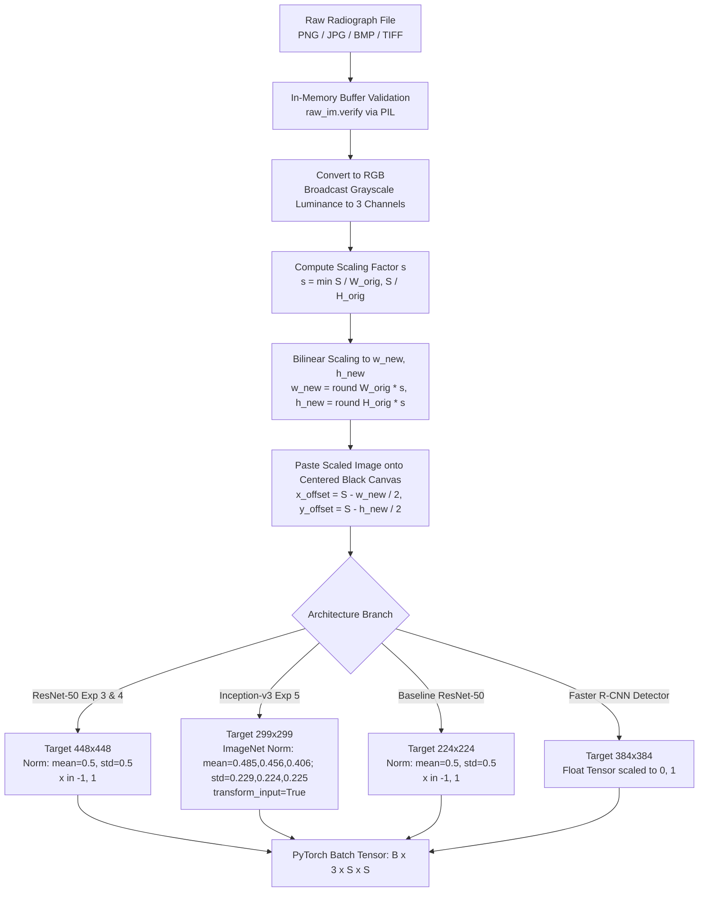

# 04. Data Preprocessing and Data Pipeline

**Project Title:** Bone Fracture Image Captioning Using Deep Learning  
**Scope:** Mathematical formulation of image ingestion, geometric transformations, aspect-ratio preserving padding, normalization constants, data augmentation, batching, and leakage prevention.  
**Source Code References:** [`preprocess.py`](file:///c:/Users/Donipudi%20Asish%20Kumar/Desktop/Deep%20learning%20project/preprocess.py), [`src/dataset.py`](file:///c:/Users/Donipudi%20Asish%20Kumar/Desktop/Deep%20learning%20project/src/dataset.py), [`inference/preprocessing.py`](file:///c:/Users/Donipudi%20Asish%20Kumar/Desktop/Deep%20learning%20project/inference/preprocessing.py)  
**Document Version:** 1.0 (Audited October 2026)  

---

## 1. Overview & Preprocessing Philosophy

In medical radiography, standard computer vision resizing approaches (e.g., directly resizing non-square radiographs to $224\times 224$ or $448\times 448$ via bilinear interpolation) alter anatomical aspect ratios. For example, compressing a tall, narrow femoral radiograph horizontally distorts cortical thickness, alters trabecular angles, and deforms fracture lines.

To preserve geometric anatomical integrity, this platform implements **deterministic aspect-ratio preserving padding** across all training, evaluation, and inference pipelines.



---

## 2. Ingestion, Bit Depth, and Validation

### 2.1 File Verification & In-Memory Loading
`[Source: inference/preprocessing.py, load_and_validate_image()]`
- Uploaded byte streams are loaded using `PIL.Image.open(io.BytesIO(file_bytes))`.
- The byte buffer is immediately checked via `raw_im.verify()` to catch truncated headers or corrupted image files before allocating GPU tensors.
- If verification fails, an `ImageValidationError` is raised, triggering an `HTTP 400 Bad Request`.

### 2.2 Grayscale Handling & Channel Broadcasting
- The underlying BoneFract dataset consists of 8-bit single-channel grayscale radiographs (`mode='L'`).
- The image is converted to 3-channel RGB via `.convert('RGB')`. This replicates the single grayscale luminance channel across the Red, Green, and Blue planes identically:
  $$I_{\text{RGB}}(x, y) = [I_{\text{gray}}(x, y), I_{\text{gray}}(x, y), I_{\text{gray}}(x, y)]$$
- This channel broadcasting allows seamless ingestion by deep convolutional backbones pretrained on ImageNet without altering underlying contrast or trabecular pixel values.

---

## 3. Mathematical Formulation of Aspect-Ratio Preserved Padding

`[Source: src/dataset.py, class ResizeAndPad & inference/preprocessing.py, resize_and_pad()]`

Let an input radiograph have width $W_{\text{orig}}$ and height $H_{\text{orig}}$. Let the square target model canvas dimension be $S \times S$, where $S \in \{224, 299, 384, 448\}$.

1. **Calculate the Uniform Scaling Factor $s$:**
   $$s = \min\left( \frac{S}{W_{\text{orig}}}, \frac{S}{H_{\text{orig}}} \right)$$

2. **Calculate New Aspect-Preserved Dimensions $(W_{\text{new}}, H_{\text{new}})$:**
   $$W_{\text{new}} = \text{round}(W_{\text{orig}} \cdot s), \quad H_{\text{new}} = \text{round}(H_{\text{orig}} \cdot s)$$
   where $W_{\text{new}} \le S$ and $H_{\text{new}} \le S$, with at least one dimension exactly equal to $S$.

3. **Compute Symmetric Centering Offsets:**
   $$X_{\text{offset}} = \left\lfloor \frac{S - W_{\text{new}}}{2} \right\rfloor, \quad Y_{\text{offset}} = \left\lfloor \frac{S - H_{\text{new}}}{2} \right\rfloor$$

4. **Canvas Composition:**
   A new solid black canvas $C$ of size $(S, S, 3)$ with pixel values $0$ is initialized. The scaled image is pasted onto $C$ at coordinates $(X_{\text{offset}}, Y_{\text{offset}})$.

---

## 4. Normalization Regimes Across Architectures

| Subsystem / Experiment | Backbone Architecture | Target Canvas ($S\times S$) | Mean Vector ($\mu$) | Std Vector ($\sigma$) | Output Tensor Range | Formula |
| :--- | :--- | :---: | :---: | :---: | :---: | :--- |
| **Baseline (Exp 1-2)** | ResNet-50 | $224 \times 224$ | $[0.5, 0.5, 0.5]$ | $[0.5, 0.5, 0.5]$ | $[-1.0, 1.0]$ | $x_{\text{norm}} = \frac{x / 255.0 - 0.5}{0.5}$ |
| **Experiment 3** | ResNet-50 | $448 \times 448$ | $[0.5, 0.5, 0.5]$ | $[0.5, 0.5, 0.5]$ | $[-1.0, 1.0]$ | $x_{\text{norm}} = \frac{x / 255.0 - 0.5}{0.5}$ |
| **Experiment 4 (Winner)** | Balanced ResNet-50 | $448 \times 448$ | $[0.5, 0.5, 0.5]$ | $[0.5, 0.5, 0.5]$ | $[-1.0, 1.0]$ | $x_{\text{norm}} = \frac{x / 255.0 - 0.5}{0.5}$ |
| **Experiment 5** | Inception-v3 | $299 \times 299$ | $[0.485, 0.456, 0.406]$ | $[0.229, 0.224, 0.225]$ | ImageNet PyTorch | Standard ImageNet with `transform_input=True` |
| **Lesion Detector** | Faster R-CNN MobileNetV3 | $384 \times 384$ | Internal TorchVision | Internal TorchVision | $[0.0, 1.0]$ | Native TorchVision detection transform |

---

## 5. Training-Time vs. Evaluation-Time Transforms

### 5.1 Training-Time Data Augmentation Pipeline
`[Source: src/dataset.py, get_transforms()]`
To prevent overfitting on repetitive positioning and clinical contrast variations, training data undergoes stochastic online augmentation:
```python
train_transforms = transforms.Compose([
    ResizeAndPad(target_size=target_size),              # 1. Aspect-ratio preserved square padding
    transforms.RandomHorizontalFlip(p=0.5),             # 2. Horizontal flip (simulates bilateral anatomy)
    transforms.RandomRotation(degrees=(-10, 10)),       # 3. Small rotation (patient positioning tilt)
    transforms.RandomAffine(degrees=0, translate=(0.04, 0.04)), # 4. Subtle translation
    transforms.ColorJitter(brightness=0.1, contrast=0.1),       # 5. Photometric exposure jitter
    transforms.ToTensor(),                              # 6. Float tensor [0.0, 1.0]
    transforms.Normalize(mean=norm_mean, std=norm_std)  # 7. Channel normalization
])
```

### 5.2 Evaluation and Inference Transformations (Zero Stochasticity)
```python
eval_transforms = transforms.Compose([
    ResizeAndPad(target_size=target_size),
    transforms.ToTensor(),
    transforms.Normalize(mean=norm_mean, std=norm_std)
])
```

---

## 6. Label Encoding and Taxonomy Mapping

### 6.1 Anatomical Region Mapping (Task 1)
7 mutually exclusive categories mapped to continuous integers:
```python
REGION_TO_IDX = {
    'Arm': 0,
    'Foot': 1,
    'Hand': 2,
    'Lower leg': 3,
    'Thigh': 4,
    'pelvis': 5,
    'wrist': 6
}
IDX_TO_REGION = {v: k for k, v in REGION_TO_IDX.items()}
```

### 6.2 Binary Fracture Status Mapping (Task 2)
```python
FRACTURE_TO_IDX = {'Negative': 0, 'Positive': 1}
IDX_TO_FRACTURE = {0: 'Negative', 1: 'Positive'}
```
- Loss Target: `0.0` for Normal/Negative, `1.0` for Fracture/Positive.
- Operating Decision Threshold: $\tau = 0.50$ applied to the sigmoid output $\sigma(z_{\text{fracture}})$.

---

## 7. Class Imbalance Mitigation Calculations

Across the 38,366 training radiographs, 27,205 are normal and 11,161 are fractured (positive prevalence 29.09%). To counter the majority-class bias without discarding negative samples, the binary cross-entropy loss includes an exact positive class weight:
$$w_{\text{pos}} = \frac{N_{\text{neg}}}{N_{\text{pos}}} = \frac{27,205}{11,161} \approx 2.437505$$
In PyTorch: `nn.BCEWithLogitsLoss(pos_weight=torch.tensor([2.438]))`. This penalizes false negatives $2.44\times$ more heavily than false positives, aligning the optimization landscape with clinical trauma priorities.

---

## 8. Anti-Leakage Investigation & Verification Summary

| Leakage Risk Category | Audit Verification Procedure | Outcome | Integrity Status |
| :--- | :--- | :---: | :--- |
| **Cross-Split Patient Overlap** | Bipartite graph connected component matching across `train.csv`, `validation.csv`, and `test.csv`. | 0 shared patients | **PASSED (100% Disjoint)** |
| **Exact Duplicate Image Collision** | MD5 hash collision checks across all 47,931 images. | 0 duplicate collisions across splits | **PASSED** |
| **Feature Normalization Leakage** | Audited normalization constants in code (`norm_mean`, `norm_std`). | Fixed hardcoded constants; no test set statistics computed. | **PASSED** |
| **Data Augmentation Leakage** | Verified transform application in `BoneFractDataset`. | Transforms executed strictly on-the-fly during training loader loop. | **PASSED** |
| **Manifest Leakage (Exp 4 & 5)** | SHA-256 and index cross-check of `reports/exp4_sample_manifest.csv`. | All 14,000 samples selected strictly from `train.csv`. | **PASSED** |

