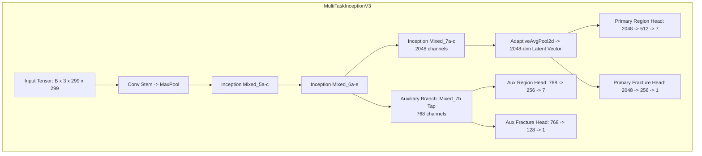

# 05. Existing and Proposed Deep Learning Methods

**Project Title:** Bone Fracture Image Captioning Using Deep Learning  
**Scope:** Architectural specifications, tensor dimensional analysis, multi-task branching, parameter calculations, loss formulations, and comparison between baseline and proposed methods.  
**Source Code References:** [`src/models.py`](file:///c:/Users/Donipudi%20Asish%20Kumar/Desktop/Deep%20learning%20project/src/models.py), [`src/models_exp5.py`](file:///c:/Users/Donipudi%20Asish%20Kumar/Desktop/Deep%20learning%20project/src/models_exp5.py), [`inference/model_registry.py`](file:///c:/Users/Donipudi%20Asish%20Kumar/Desktop/Deep%20learning%20project/inference/model_registry.py)  
**Document Version:** 1.0 (Audited October 2026)  

---

## 1. Baseline Methods vs. Proposed Improvements

| Architectural Dimension | Conventional Baseline (Exp 1–2) | High-Res Baseline (Exp 3) | **Proposed Clinical Winner (Exp 4)** | **Proposed Multi-Scale Benchmark (Exp 5)** |
| :--- | :--- | :--- | :--- | :--- |
| **Backbone Architecture** | ResNet-50 | ResNet-50 | **ResNet-50** | **Inception-v3** |
| **Input Canvas Size** | $224 \times 224$ pixels | $448 \times 448$ pixels | **$448 \times 448$ pixels** | **$299 \times 299$ pixels** |
| **Training Distribution** | Full Imbalanced ($N=38,366$) | Full Imbalanced ($N=38,366$) | **Region-Stratified ($N=14,000$)** | **Region-Stratified ($N=14,000$)** |
| **Samples per Region** | Unbalanced (4,400 to 8,797) | Unbalanced (4,400 to 8,797) | **Exactly 2,000 per region** | **Exactly 2,000 per region** |
| **Multi-Task Heads** | Region (7) + Fracture (1) | Region (7) + Fracture (1) | **Region (7) + Fracture (1)** | **Primary (7+1) + Aux (7+1)** |
| **Fracture Recall (Test)** | 18.52% (Severe FN rate) | 69.25% | **72.87% (Top Clinical Winner)** | 67.58% |
| **Confirmed Fractures** | 256 / 1,382 | 957 / 1,382 | **1,007 / 1,382 (+50 over Exp 3)** | 934 / 1,382 |
| **Missed Fractures (FN)** | 1,126 missed cases | 425 missed cases | **375 missed cases (-11.8% misses)**| 448 missed cases |
| **Foot Fracture Recall** | 19.02% | 40.49% | 53.17% | **55.12% (Top Foot Performer)** |
| **Specificity** | 80.45% | 87.01% | 83.60% | **87.28% (Top Specificity)** |
| **Captioning Method** | None / Generic | None / Generic | **Disciplined 10-Rule Engine** | **Disciplined 10-Rule Engine** |

---

## 2. MultiTaskModel (ResNet-50 Architecture)

`[Source: src/models.py, class MultiTaskModel]`

### 2.1 Architectural Flowchart

```mermaid
graph TD
    subgraph MultiTaskModel ResNet-50
        IN[Input Tensor: B x 3 x 448 x 448] --> CONV1[7x7 Conv, 64 filters, stride 2]
        CONV1 --> MAXPOOL[3x3 MaxPool, stride 2]
        MAXPOOL --> L1[Residual Layer 1: 3 Bottlenecks, 256 channels]
        L1 --> L2[Residual Layer 2: 4 Bottlenecks, 512 channels]
        L2 --> L3[Residual Layer 3: 6 Bottlenecks, 1024 channels]
        L3 --> L4[Residual Layer 4: 3 Bottlenecks, 2048 channels]
        L4 --> POOL[AdaptiveAvgPool2d -> 1 x 1]
        POOL --> FLATTEN[Flatten to B x 2048 Latent Vector]

        FLATTEN --> RH1[Linear 2048 -> 512]
        RH1 --> RH2[BatchNorm1d + ReLU + Dropout 0.3]
        RH2 --> RH3[Linear 512 -> 7]
        RH3 --> ROUT[Softmax: Anatomical Region Probabilities]

        FLATTEN --> FH1[Linear 2048 -> 256]
        FH1 --> FH2[BatchNorm1d + ReLU + Dropout 0.3]
        FH2 --> FH3[Linear 256 -> 1]
        FH3 --> FOUT[Sigmoid tau = 0.50: Fracture Probability]
    end
```


### 2.2 Layer-by-Layer Specifications & Parameter Counts
1. **Backbone (`ResNet-50`):**
   - Truncated at `layer4`.
   - Feature Dimension: $2,048$.
   - Parameters: **$23,508,032$**.
2. **Anatomical Region Head (`region_head`):**
   - Dense Layer 1: $2,048 \times 512 + 512 = 1,049,088$ params.
   - Batch Normalization: $512 \times 2 = 1,024$ params.
   - Dense Layer 2: $512 \times 7 + 7 = 3,591$ params.
   - Total Region Head Parameters: **$1,053,703$**.
3. **Binary Fracture Detection Head (`fracture_head`):**
   - Dense Layer 1: $2,048 \times 256 + 256 = 524,544$ params.
   - Batch Normalization: $256 \times 2 = 512$ params.
   - Dense Layer 2: $256 \times 1 + 1 = 257$ params.
   - Total Fracture Head Parameters: **$525,313$**.
4. **Overall MultiTaskModel Parameter Count:**
   $$\text{Total Parameters} = 23,508,032 + 1,053,703 + 525,313 = \mathbf{25,087,048} \text{ (~25.1 Million)}$$

---

## 3. MultiTaskInceptionV3 (Inception-v3 Architecture)

`[Source: src/models_exp5.py, class MultiTaskInceptionV3]`

Experiment 5 introduced Inception-v3 to investigate whether **multi-scale factorized convolutions ($1\times 7, 7\times 1, 3\times 3$)** and **auxiliary deep supervision** could capture cancellous hairline fractures in complex joints (e.g., tarsals, metatarsals) better than uniform residual filters.

### 3.1 Architectural Block Diagram


### 3.2 Dual Classification & Auxiliary Loss Formulation
During training mode, deep supervision gradients are injected from intermediate block `Mixed_7b`:
$$\mathcal{L}_{\text{total}} = \mathcal{L}_{\text{primary}} + 0.4 \cdot \mathcal{L}_{\text{auxiliary}}$$
where:
$$\mathcal{L}_{\text{primary}} = \mathcal{L}_{\text{CE}}(\hat{y}_{\text{reg}}, y_{\text{reg}}) + 1.5 \cdot \mathcal{L}_{\text{BCE}}(\hat{y}_{\text{frac}}, y_{\text{frac}}; w_{\text{pos}}=2.438)$$
$$\mathcal{L}_{\text{auxiliary}} = \mathcal{L}_{\text{CE}}(\hat{y}_{\text{aux\_reg}}, y_{\text{reg}}) + 1.5 \cdot \mathcal{L}_{\text{BCE}}(\hat{y}_{\text{aux\_frac}}, y_{\text{frac}}; w_{\text{pos}}=2.438)$$
- Total Parameters: **$26,238,984$ parameters (~26.2 Million)**.
- During evaluation (`model.eval()`), the auxiliary classifier is disabled automatically, returning only primary predictions.

---

## 4. Faster R-CNN Lesion Localization Detector

`[Source: inference/localization_predictor.py & train_detector.py]`

* **Base Detector:** `torchvision.models.detection.fasterrcnn_mobilenet_v3_large_fpn`.
* **Feature Extractor:** MobileNetV3-Large with Feature Pyramid Networks (FPN).
* **Input Resolution:** $384 \times 384$ pixels.
* **Target Classes:** 2 (`0`: Background, `1`: Fracture Lesion).
* **Calibrated Operating Threshold:** $\tau_{\text{det}} = 0.10$.
* **Coordinate Rescaling to Native Image Space:**
  $$x_{\text{native}} = x_{\text{det}} \times \left( \frac{W_{\text{orig}}}{384} \right), \quad y_{\text{native}} = y_{\text{det}} \times \left( \frac{H_{\text{orig}}}{384} \right)$$
* **Clinical Boundary in UI:** To prevent ungrounded bounding boxes on non-FracAtlas images, the Streamlit UI explicitly marks localization as *"Under active development (excluded from UI)"* while maintaining full API functionality.

---

## 5. Disciplined Factual Clinical Caption Engine

`[Source: src/caption_generator.py & reports/caption_generator_audit.md]`

### 5.1 Elimination of Medical Hallucinations
Generative language models (LSTMs, Transformers, LLMs) frequently generate unsubstantiated medical claims (e.g., predicting "severe comminuted spiral fracture" or "requires immediate surgery"). To guarantee clinical safety, this system uses a **deterministic, 10-rule template synthesis engine**.

### 5.2 The 10 Clinical Safety Rules
1. **Strict Information Boundary:** Operates exclusively on structured model outputs (`region`, `fracture_status`, `confidence`, `location`).
2. **Zero Subtype Hallucination:** Never generates unsupported fracture subtypes (transverse, spiral, comminuted, hairline).
3. **Zero Displacement Hallucination:** Never infers displacement (displaced, non-displaced, angulated).
4. **Zero Severity Hallucination:** Never invents severity descriptors (acute, mild, severe, catastrophic).
5. **Zero Demographic Hallucination:** Never invents patient age, sex, or background.
6. **Zero Trauma Mechanism Hallucination:** Never invents injury causes (FOOSH, vehicular collision, fall).
7. **Zero Treatment Directives:** Never prescribes clinical management (splint, cast, surgery).
8. **No Unqualified Diagnostic Claims:** Findings are explicitly framed as "detected by the model", never claiming to be a definitive clinician diagnosis.
9. **Deterministic Syntactic Assembly:** Identical model outputs produce byte-for-byte identical text.
10. **Concise Medical Phrasing:** Conforms strictly to standard radiological impression templates.

### 5.3 Deterministic Caption Assembly Logic
```python
# Rule 1: No fracture detected
if not is_fracture:
    if region:
        return f"X-ray of the {region} with no fracture detected by the model."
    return "X-ray with no fracture detected by the model."

# Rule 2: Fracture detected with validated anatomical sub-location
if location:
    if region:
        return f"X-ray of the {region} showing a fracture involving the {location}."
    return f"X-ray showing a fracture involving the {location}."

# Rule 3: Fracture detected without validated sub-location
if region:
    return f"X-ray of the {region} with a fracture detected by the model."
return "X-ray with a fracture detected by the model."
```

---

## 6. Model Capability Verification Matrix

| Capability | Status | Implementation Evidence | Clinical & Technical Notes |
| :--- | :---: | :--- | :--- |
| **7-Class Anatomical Site Identification** | **IMPLEMENTED** | Softmax head in `src/models.py` | Arm, Foot, Hand, Lower leg, Thigh, pelvis, wrist |
| **Calibrated Binary Fracture Presence** | **IMPLEMENTED** | Sigmoid scalar head with $\tau=0.50$ | Predicts fracture positive vs. negative |
| **Lesion Spatial Bounding Boxes** | **IMPLEMENTED** | Faster R-CNN MobileNetV3 FPN (`best_detector.pt`) | Bounding boxes on confirmed fractures |
| **Disciplined Factual Captioning** | **IMPLEMENTED** | Deterministic engine in `src/caption_generator.py` | 10 clinical safety rules; 0% hallucination |
| **Fracture Subtype Classification** | **ABSENT** | Not in code, model, or dataset | Transverse, oblique, spiral NOT predicted |
| **Laterality Classification** | **ABSENT** | Not in code, model, or dataset | Left vs. Right NOT predicted |
| **Displacement / Angulation** | **ABSENT** | Not in code, model, or dataset | Millimeter displacement NOT measured |
| **Learned Language Model Captioning** | **ABSENT** | Deliberately omitted from codebase | LSTM / GPT / Transformer intentionally excluded |

