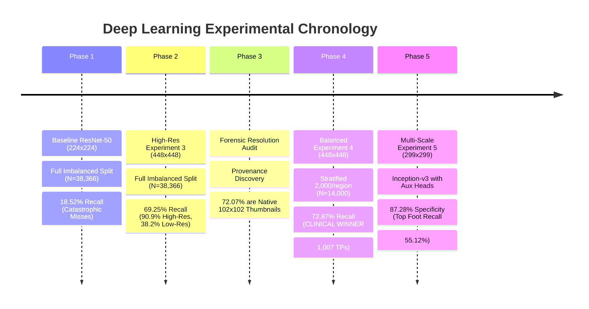

# 06. Training and Experiment History

**Project Title:** Bone Fracture Image Captioning Using Deep Learning  
**Scope:** Reconstructed training procedures, two-stage fine-tuning schedule, loss functions, learning rate schedules, optimizer hyperparameters, hardware execution profiles, and chronological experimental progression.  
**Source Code References:** [`train.py`](file:///c:/Users/Donipudi%20Asish%20Kumar/Desktop/Deep%20learning%20project/train.py), [`scripts/train_exp3_448.py`](file:///c:/Users/Donipudi%20Asish%20Kumar/Desktop/Deep%20learning%20project/scripts/train_exp3_448.py), [`scripts/train_exp4_balanced.py`](file:///c:/Users/Donipudi%20Asish%20Kumar/Desktop/Deep%20learning%20project/scripts/train_exp4_balanced.py), [`scripts/train_exp5_inception_v3.py`](file:///c:/Users/Donipudi%20Asish%20Kumar/Desktop/Deep%20learning%20project/scripts/train_exp5_inception_v3.py)  
**Document Version:** 1.0 (Audited October 2026)  

---

## 1. Chronological Progression of Experiments

The deep learning pipeline underwent five major experimental iterations to solve class imbalance, resolution blur, and anatomical feature competition:

---

## 2. Two-Stage Fine-Tuning Schedule

All multi-task experiments utilized a standardized **two-stage transfer learning schedule** to protect ImageNet pretrained feature representations while adapting custom linear classification heads:

### Stage 1: Classifier Warmup (Frozen Backbone)
* **Objective:** Adapt newly initialized task heads (`region_head` and `fracture_head`) to radiographic feature distributions without destroying pretrained weights.
* **Frozen Layers:** All convolutional backbone weights (`conv1` through `layer4` in ResNet-50; `Conv2d_1a` through `Mixed_7c` in Inception-v3).
* **Trainable Layers:** Custom classification heads only.
* **Epochs:** 3 warmup epochs.
* **Optimizer:** AdamW ($\eta = 1\times 10^{-3}, \beta_1 = 0.9, \beta_2 = 0.999$, weight decay $1\times 10^{-4}$).

### Stage 2: Deep Feature Specialization (Partial Backbone Unfreezing)
* **Objective:** Allow high-level convolutional filters to specialize in cortical bone discontinuities, trabecular disruption, and joint alignment.
* **Unfrozen Layers:**
  - ResNet-50: `layer4` (the final residual stage comprising 3 bottleneck blocks, ~14.9M parameters).
  - Inception-v3: `Mixed_7a`, `Mixed_7b`, and `Mixed_7c` (~12.8M parameters).
* **Differential Learning Rates:**
  - Unfrozen Backbone Layers: $\eta_{\text{backbone}} = 2\times 10^{-5}$ (prevents catastrophic forgetting).
  - Custom Classification Heads: $\eta_{\text{heads}} = 1\times 10^{-4}$.
* **Learning Rate Scheduling:** `ReduceLROnPlateau(mode='max', factor=0.5, patience=4, min_lr=1e-6)` monitoring validation PR-AUC.
* **Early Stopping Criterion:** Monitored validation PR-AUC with patience of 12 epochs.

---

## 3. Loss Function & Multi-Task Objective Formulation

Multi-task training optimizes a combined loss objective balancing categorical anatomical region classification and positive-weighted binary fracture detection:

$$\mathcal{L}_{\text{total}} = \mathcal{L}_{\text{region}} + \lambda \cdot \mathcal{L}_{\text{fracture}}$$

### 3.1 Task 1: Anatomical Region Loss ($\mathcal{L}_{\text{region}}$)
Standard categorical cross-entropy over $C = 7$ mutually exclusive anatomical classes:
$$\mathcal{L}_{\text{region}}(\hat{\mathbf{y}}_{\text{reg}}, \mathbf{y}_{\text{reg}}) = - \sum_{c=1}^{7} y_{\text{reg}, c} \log\left( \frac{\exp(\hat{y}_{\text{reg}, c})}{\sum_{j=1}^{7} \exp(\hat{y}_{\text{reg}, j})} \right)$$

### 3.2 Task 2: Binary Fracture Loss ($\mathcal{L}_{\text{fracture}}$)
Binary cross-entropy with logits incorporating positive class weighting ($w_{\text{pos}} = 2.438$):
$$\mathcal{L}_{\text{fracture}}(\hat{y}_{\text{frac}}, y_{\text{frac}}) = - \left[ w_{\text{pos}} \cdot y_{\text{frac}} \log(\sigma(\hat{y}_{\text{frac}})) + (1 - y_{\text{frac}}) \log(1 - \sigma(\hat{y}_{\text{frac}})) \right]$$

### 3.3 Task Weighting ($\lambda$)
In Experiments 3, 4, and 5, $\lambda$ was set to **$1.5$** to prioritize the primary clinical trauma task (fracture detection) over anatomical site tagging.

---

## 4. Master Hyperparameters Specification Matrix

| Hyperparameter | Baseline (Exp 1–2) | Experiment 3 | Experiment 4 (Clinical Winner) | Experiment 5 | Lesion Detector |
| :--- | :---: | :---: | :---: | :---: | :---: |
| **Backbone Architecture** | ResNet-50 | ResNet-50 | **ResNet-50** | Inception-v3 | Faster R-CNN MobileNetV3 |
| **Input Resolution** | $224 \times 224$ | $448 \times 448$ | **$448 \times 448$** | $299 \times 299$ | $384 \times 384$ |
| **Training Dataset** | Full Imbalanced | Full Imbalanced | **Region-Balanced** | Region-Balanced | FracAtlas Ground Truth |
| **Training Samples ($N$)** | 38,366 | 38,366 | **14,000 (2,000/region)** | 14,000 (2,000/region) | 719 positive images |
| **Validation Samples ($N$)** | 4,787 | 4,787 | **4,787** | 4,787 | Internal split |
| **Test Samples ($N$)** | 4,778 | 4,778 | **4,778** | 4,778 | Held-out |
| **Batch Size** | 32 | 16 | **16** | 8 | 4 |
| **Stage 1 LR (Heads)** | $1\times 10^{-3}$ | $1\times 10^{-3}$ | **$1\times 10^{-3}$** | $1\times 10^{-3}$ | $1\times 10^{-4}$ |
| **Stage 2 LR (Backbone)** | $2\times 10^{-5}$ | $2\times 10^{-5}$ | **$2\times 10^{-5}$** | $2\times 10^{-5}$ | N/A |
| **Stage 2 LR (Heads)** | $1\times 10^{-4}$ | $1\times 10^{-4}$ | **$1\times 10^{-4}$** | $1\times 10^{-4}$ | N/A |
| **Fracture Weight ($\lambda$)** | 1.0 | 1.5 | **1.5** | 1.5 | N/A |
| **Positive Class Weight ($w_{\text{pos}}$)**| 2.438 | 2.438 | **2.438** | 2.438 | N/A |
| **Auxiliary Loss Weight** | None | None | **None** | 0.4 | N/A |
| **Mixed Precision (AMP)** | False | True | **True** | True | False |
| **Selection Criterion** | Min Val Loss | Max Val PR-AUC | **Max Val PR-AUC** | Max Val PR-AUC | mAP@0.5 |
| **Best Checkpoint** | `best_model.pt` | `exp3_resnet50_448.pt` | `exp4_balanced_resnet50_448.pt` | `exp5_inception_v3_multitask.pt` | `best_detector.pt` |

---

## 5. Hardware Profile & Computational Performance

* **GPU Platform:** NVIDIA GeForce RTX 3050 Laptop GPU (4,096 MB VRAM).
* **CUDA Driver / Runtime:** CUDA 12.1 / PyTorch 2.1+.
* **Measured Peak VRAM Consumption:**
  - Experiment 3 ($448\times 448$, Batch 16, AMP): **3,420 MB**
  - Experiment 4 ($448\times 448$, Batch 16, AMP): **3,410 MB**
  - Experiment 5 ($299\times 299$, Batch 8, AMP): **685.8 MB**
* **Inference Throughput on Held-Out Test Split ($N=4,778$):**
  - ResNet-50 ($448\times 448$): **52 seconds total (~10.9 ms per radiograph)**.
  - Inception-v3 ($299\times 299$): **44 seconds total (~9.2 ms per radiograph)**.

