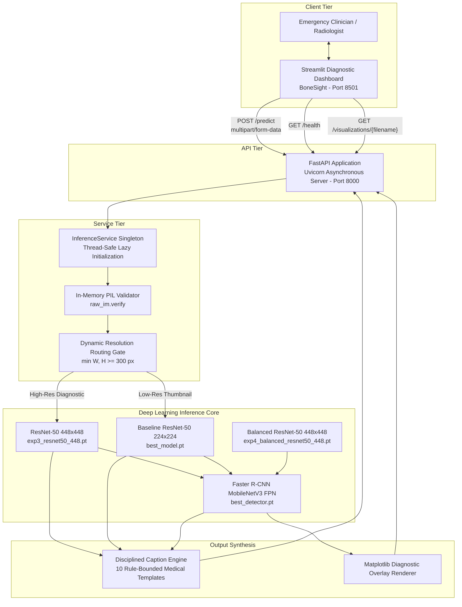
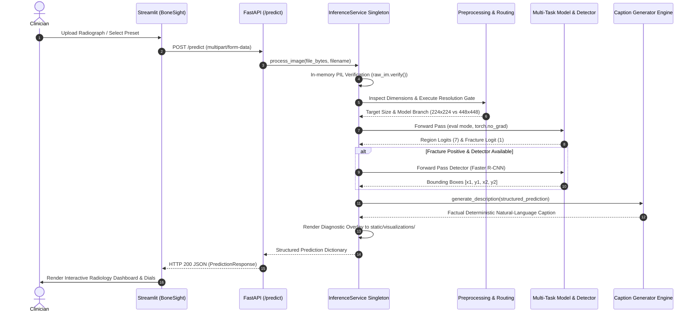

# 09. Web Application and Serving Architecture

**Project Title:** Bone Fracture Image Captioning Using Deep Learning  
**Scope:** Full-stack architecture, FastAPI REST API microservice, Streamlit clinical dashboard (*BoneSight*), Pydantic schemas, inference lifecycle, security controls, and operational commands.  
**Source Code References:** [`backend/main.py`](file:///c:/Users/Donipudi%20Asish%20Kumar/Desktop/Deep%20learning%20project/backend/main.py), [`backend/schemas.py`](file:///c:/Users/Donipudi%20Asish%20Kumar/Desktop/Deep%20learning%20project/backend/schemas.py), [`backend/services/inference_service.py`](file:///c:/Users/Donipudi%20Asish%20Kumar/Desktop/Deep%20learning%20project/backend/services/inference_service.py), [`frontend/app.py`](file:///c:/Users/Donipudi%20Asish%20Kumar/Desktop/Deep%20learning%20project/frontend/app.py)  
**Document Version:** 1.0 (Audited October 2026)  

---

## 1. System Architecture Overview

The system implements a decoupled, production-grade microservice architecture:
1. **Inference Backend (FastAPI):** High-throughput asynchronous REST microservice running under Uvicorn on port 8000. Houses model state in GPU memory and performs byte validation, resolution routing, neural forward passes, and factual caption assembly.
2. **Clinical Workstation (Streamlit):** Dedicated diagnostic radiology user interface (*BoneSight*, 1,337 lines) running on port 8501. Communicates with the backend exclusively via HTTP multipart REST requests.



---

## 2. End-to-End Prediction Sequence Diagram



---

## 3. Backend REST Microservice (FastAPI)

`[Source: backend/main.py & backend/schemas.py]`

### 3.1 REST API Endpoint Specification

| HTTP Method | Route | Request Input | Response Schema | Purpose & Function | Error Status Codes |
| :--- | :--- | :--- | :--- | :--- | :--- |
| **`GET`** | `/health` | None | `HealthResponse` | Liveness and readiness health probe. | None (always 200 OK) |
| **`POST`** | `/predict` | Multipart file (`image: UploadFile`) | `PredictionResponse` | Ingests radiograph, executes resolution routing, runs multi-task model, outputs caption. | `400` (corrupted/invalid image), `500` (inference failure), `503` (service initializing) |
| **`GET`** | `/visualizations/{filename}` | Path parameter (`filename: str`) | Image file (`image/png`) | Serves annotated diagnostic overlay images. Guards against path traversal. | `400` (path traversal detected), `404` (not found or expired) |
| **`GET`** | `/downloads/{filename}` | Path parameter (`filename: str`) | File stream (PDF, DOCX, PNG) | Serves architectural diagrams, PDFs, and thesis assets. Guards against path traversal. | `400` (invalid identifier), `404` (file not found) |

### 3.2 Pydantic Data Contracts (`backend/schemas.py`)
```python
class BoundingBoxSchema(BaseModel):
    box_2d: List[float] = Field(..., description="[x1, y1, x2, y2] native image coordinates")
    confidence: float
    label: str

class PredictionResponse(BaseModel):
    success: bool = True
    anatomical_region: Optional[str]
    region_confidence: Optional[float]
    fracture_detected: bool
    fracture_probability: float
    operating_threshold: float = 0.50
    caption: str
    uncertain_anatomy: bool = False
    localization_available: bool = False
    localization: Optional[List[BoundingBoxSchema]] = None
    visualization_url: Optional[str] = None
    execution_time_ms: Optional[float] = None
```

### 3.3 Security & Path Traversal Guards
All static file serving endpoints enforce path traversal sanitization:
```python
clean_filename = os.path.basename(filename)
if clean_filename != filename:
    raise HTTPException(status_code=400, detail="Invalid file identifier.")
```
This strictly prevents attackers from utilizing `../` sequences to read sensitive system files.

---

## 4. Frontend Clinical Diagnostic Workstation (*BoneSight*)

`[Source: frontend/app.py]`

The frontend is a dedicated clinical diagnostic dashboard built in Streamlit (1,337 lines) utilizing a light medical design system.

### 4.1 Design System & Typography
* **Color Palette:**
  - Medical Navy (`#123B5D`): Primary headers, brand identity, structural frame.
  - Steel Teal (`#1F6F8B`): Secondary buttons, interactive accents.
  - Soft Clinical Slate (`#F5F8FA`): Clean high-contrast canvas background.
  - Signal Alert Red (`#E63946`): Positive fracture badges and alert cards.
  - Confidence Emerald (`#2A9D8F`): Normal bone clearance badges.
* **Safe DOM Injection:** All custom HTML components utilize `render_html()` which strips leading whitespace from strings before injection. This completely prevents Streamlit's Markdown parser from incorrectly formatting HTML as indented code blocks (`<pre><code>`).

### 4.2 Interactive Diagnostic Workstation Features
1. **Interactive Preset Loaders:** One-click preloading of genuine clinical radiographs across diverse anatomical sites (`Hand`, `Foot`, `Wrist`, `Thigh`).
2. **DICOM Contrast Inversion:** Live client-side photometric inversion toggle (black-on-white vs. white-on-black) aiding detection of subtle cortical hairline cracks.
3. **Calibrated Confidence Dials:** Visual gauge displaying calibrated fracture probability against the $0.50$ clinical operating threshold.
4. **Top-3 Anatomical Region Probabilities:** Interactive bar chart displaying regional classification confidence and flagging anatomical uncertainty if confidence $< 0.40$.
5. **Factual Summary Card:** Direct rendering of the disciplined clinical caption with clear provenance labeling.
6. **Raw JSON Inspector:** Full transparency view allowing radiologists to inspect raw API response dictionaries.
7. **Clinical Report Export:** Instant export of diagnostic findings for patient records.

---

## 5. Deployment and Operational Commands

### 5.1 Step 1: Environment Activation
```powershell
# Windows
.venv\Scripts\activate

# Linux / macOS
source .venv/bin/activate
```

### 5.2 Step 2: Launch the FastAPI Backend
```powershell
uvicorn backend.main:app --host 127.0.0.1 --port 8000
```
- Liveness check: `curl http://127.0.0.1:8000/health` $\rightarrow$ `{"status":"ok"}`
- Interactive OpenAPI Swagger docs: `http://127.0.0.1:8000/docs`

### 5.3 Step 3: Launch the Streamlit Diagnostic Dashboard
In a separate terminal:
```powershell
streamlit run frontend/app.py --server.port 8501
```
Access the application at `http://localhost:8501`.

### 5.4 Step 4: Single-Image CLI Inference
```powershell
python predict.py --image tests/sample_hand.jpg
```

