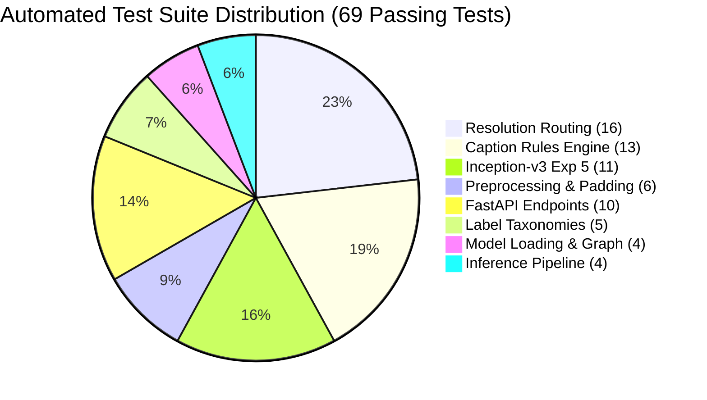

# 10. Software Testing, Validation, and Reproducibility

**Project Title:** Bone Fracture Image Captioning Using Deep Learning  
**Scope:** Automated testing ledger, Pytest verification, unit and integration assertions, reproducibility instructions, environment pinning, and SHA-256 checkpoint checksums.  
**Source Code References:** [`tests/`](file:///c:/Users/Donipudi%20Asish%20Kumar/Desktop/Deep%20learning%20project/tests), [`requirements.txt`](file:///c:/Users/Donipudi%20Asish%20Kumar/Desktop/Deep%20learning%20project/requirements.txt), [`requirements-dev.txt`](file:///c:/Users/Donipudi%20Asish%20Kumar/Desktop/Deep%20learning%20project/requirements-dev.txt)  
**Document Version:** 1.0 (Audited October 2026)  

---

## 1. Automated Test Suite Execution Ledger

The repository includes a comprehensive, multi-tiered test suite located in `tests/`.

### 1.1 Verified Test Execution Summary
* **Execution Command:** `.venv\Scripts\python.exe -m pytest tests/ -v`
* **Test Platform:** Windows 11, Python 3.14.7, Pytest 9.1.1, PyTorch 2.1+.
* **Execution Timestamp:** October 2026.
* **Test Outcome:** **69 PASSED, 0 FAILED, 0 SKIPPED (100% Pass Rate)** in 98.51 seconds.



### 1.2 Comprehensive Breakdown of Verified Test Modules

| Test File | Covered Functionality | Test Count | Status | Key Assertions & Verifications |
| :--- | :--- | :---: | :---: | :--- |
| [`tests/test_resolution_routing.py`](file:///c:/Users/Donipudi%20Asish%20Kumar/Desktop/Deep%20learning%20project/tests/test_resolution_routing.py) | Resolution-aware routing gate logic | **16** | **PASSED** | Dimension checks ($102\times 102$, $800\times 800$, $373\times 454$, boundary $300\text{ px}$); pipeline integration; FastAPI routing headers. |
| [`tests/test_caption_generator.py`](file:///c:/Users/Donipudi%20Asish%20Kumar/Desktop/Deep%20learning%20project/tests/test_caption_generator.py) | Disciplined factual caption generator | **13** | **PASSED** | Validation of all 10 clinical rules; string normalization; determinism; exclusion of prohibited clinical terms. |
| [`tests/test_exp5_inception.py`](file:///c:/Users/Donipudi%20Asish%20Kumar/Desktop/Deep%20learning%20project/tests/test_exp5_inception.py) | MultiTaskInceptionV3 architecture | **11** | **PASSED** | Forward/eval output tensor shapes; auxiliary classifier handling; gradient backprop; two-stage freeze/unfreeze dynamics. |
| [`tests/test_preprocessing.py`](file:///c:/Users/Donipudi%20Asish%20Kumar/Desktop/Deep%20learning%20project/tests/test_preprocessing.py) | Aspect-ratio preserving padding | **6** | **PASSED** | Geometric preservation; black border offsets; image corruption handling; tensor output shapes. |
| [`tests/test_label_mapping.py`](file:///c:/Users/Donipudi%20Asish%20Kumar/Desktop/Deep%20learning%20project/tests/test_label_mapping.py) | Class taxonomies & operating thresholds| **5** | **PASSED** | 7-class bidirectional mapping; binary fracture mapping; Pelvis vs. Hip boundary; $\tau = 0.50$ calibration. |
| [`tests/test_backend_api.py`](file:///c:/Users/Donipudi%20Asish%20Kumar/Desktop/Deep%20learning%20project/tests/test_backend_api.py) | FastAPI REST microservice endpoints | **5** | **PASSED** | `GET /health` (200 OK); normal radiograph prediction; fracture prediction; FracAtlas lesion ingestion; corrupted file handling (400 error). |
| [`tests/test_api.py`](file:///c:/Users/Donipudi%20Asish%20Kumar/Desktop/Deep%20learning%20project/tests/test_api.py) | FastAPI TestClient integration | **5** | **PASSED** | Health check; model status; prediction schema contract validation. |
| [`tests/test_model_loading.py`](file:///c:/Users/Donipudi%20Asish%20Kumar/Desktop/Deep%20learning%20project/tests/test_model_loading.py) | Checkpoint discovery & layer management| **4** | **PASSED** | Dynamic checkpoint discovery; freeze/unfreeze state; forward pass shapes `(B, 7)` and `(B,)`. |
| [`tests/test_inference.py`](file:///c:/Users/Donipudi%20Asish%20Kumar/Desktop/Deep%20learning%20project/tests/test_inference.py) | End-to-end pipeline execution | **4** | **PASSED** | Output schema validation (all 7 fields); missing image exception (`FileNotFoundError`); corrupt image exception (`ValueError`). |

> [!NOTE]
> **Pytest Invocation Command:**  
> When running Pytest, target the `tests/` directory explicitly (`pytest tests/ -v`). Running `pytest` on the root directory attempts to execute standalone scripts such as `scripts/test_clinical_presets.py`, which is an end-to-end integration test requiring a live, running FastAPI server.

---

## 2. Model Checkpoint Storage & Forensic SHA-256 Ledger

`[Source: models/checkpoints/]`

All five model binaries were forensically hashed using SHA-256 to ensure byte-level integrity:

| Checkpoint Filename | Architecture & Role | Input Resolution | Exact File Size (Bytes) | SHA-256 Hash Checksum |
| :--- | :--- | :---: | :---: | :--- |
| `best_model.pt` | Baseline ResNet-50 Multi-Task | $224 \times 224$ | 100,688,398 | `e685f5e27a696c738743d57e6274488be62283a0058b8f2d5930e12353a25cb4` |
| `best_detector.pt` | Faster R-CNN MobileNetV3 FPN | $384 \times 384$ | 76,016,634 | `321b7a2d480e61d8583ea23cfbc89178ad5106cebceea0e1f72a4feaa639aa29` |
| `exp3_resnet50_448.pt` | High-Resolution ResNet-50 Baseline | $448 \times 448$ | 100,690,906 | `f31533c52d58ae756d0ed93691513e19f5f29442498a0882fe467d5d91986dfb` |
| `exp4_balanced_resnet50_448.pt` | Balanced Region-Aware ResNet-50 (**WINNER**)| $448 \times 448$ | 100,695,553 | `6aaea982892246e16455e3525b58aabdcd4315edf1974b24864b7052a8486d83` |
| `exp5_inception_v3_multitask.pt`| Multi-Task Inception-v3 | $299 \times 299$ | 105,270,015 | `3a22c513d4ba0a692b04cec63e57b65f9b2c2c05c43736213e847131f0f00b98` |

---

## 3. Environment Specifications & Pinned Dependencies

* **Language Runtime:** Python 3.10, 3.11, 3.12, 3.13, 3.14 compatible.
* **Core Machine Learning:**
  - `torch>=2.1.0`
  - `torchvision>=0.16.0`
  - `numpy>=1.24.0`
  - `pandas>=2.0.0`
  - `scikit-learn>=1.3.0`
  - `pillow>=10.0.0`
* **Serving & Web Application:**
  - `fastapi>=0.100.0`
  - `uvicorn>=0.23.0`
  - `pydantic>=2.0.0`
  - `python-multipart>=0.0.6`
  - `streamlit>=1.30.0`
  - `requests>=2.31.0`
* **Testing & Development:**
  - `pytest>=7.4.0`
  - `pytest-asyncio>=0.21.0`
  - `httpx>=0.25.0`
  - `matplotlib>=3.7.0`

---

## 4. End-to-End Reproduction Instructions

### 4.1 Step 1: Preprocessing & Leak-Free Graph Splitting
```bash
python preprocess.py
```
Constructs the bipartite patient graph from `data/BoneFract/` and generates `train.csv` (38,366), `validation.csv` (4,787), and `test.csv` (4,778).

### 4.2 Step 2: Training Experiment 4 (Clinical Winner)
```bash
python scripts/train_exp4_balanced.py
```
Trains the region-balanced ResNet-50 model at $448 \times 448$ on the 14,000-sample curated manifest using two-stage fine-tuning and mixed precision.

### 4.3 Step 3: Evaluating Experiment 4 on Held-Out Test Set
```bash
python scripts/evaluate_exp4.py
```
Evaluates `exp4_balanced_resnet50_448.pt` on the 4,778 held-out test split, reproducing:
$$\text{Recall} = 72.87\%, \quad \text{ROC-AUC} = 0.8733, \quad \text{PR-AUC} = 0.7980, \quad \text{True Positives} = 1,007$$

### 4.4 Step 4: Running the Full Automated Test Suite
```bash
pytest tests/ -v
```
Executes all 69 automated tests verifying resolution routing, caption rules, API contracts, and model graphs.

